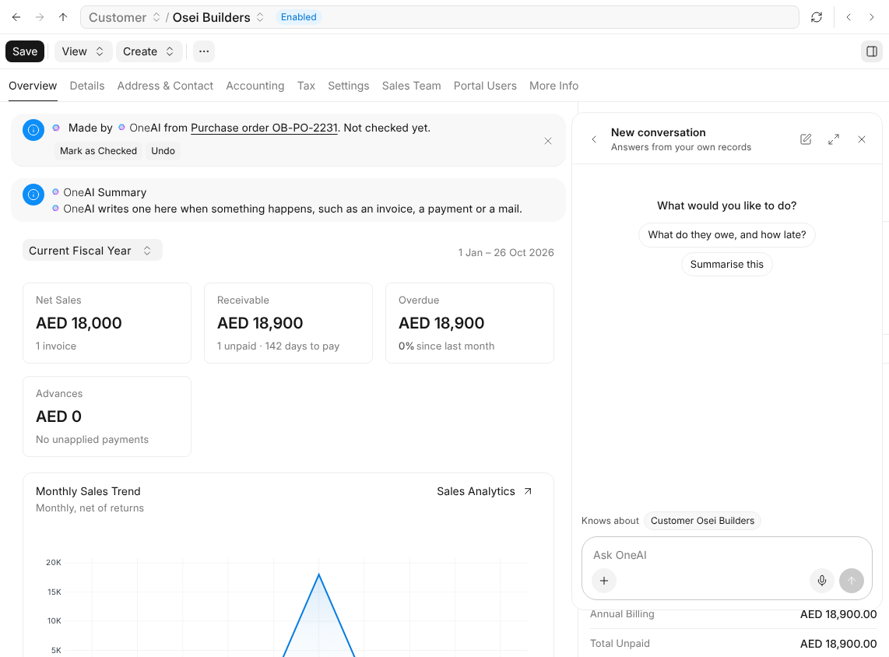

OneAI is the assistant in every part of One. This is the version it is
released at.

- Ask it anything, about what is on screen or how One works, in your own
  language. It reads only what you could open yourself.
- When you ask for a change, it suggests it on a card, and nothing happens
  until you approve it.
- It reads the mail and files that arrive where you let it, files them with
  the right record, and keeps a short summary at the top of your customers,
  suppliers, opportunities and projects.
- One chooses the models; your workspace chooses a tier, Fast, Balanced or
  Full. Balanced is where every workspace starts.
- AICenter holds everything about OneAI that can be set, including the
  Knowledge it reads with every answer, which OneAI Managers write too. Web
  search can be turned on in TrustCenter.

HelpCenter explains all of it, starting with What OneAI Is.

