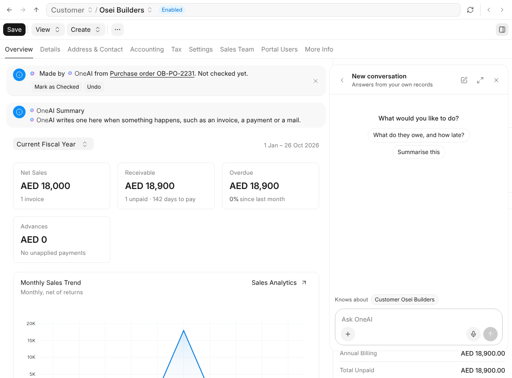

# What OneAI Is

OneAI is the assistant in every part of One. Ask it about your work, or how
something in One works, in your own words and language, and it answers from
your own records and from One's guides. It also reads the mail and files
that arrive, and files them where they belong.

> **OneAI never changes anything by itself when you ask it.** It suggests the
> change on a card, and nothing happens until you approve it.

## Where You Meet It

| Where | What it does there |
| --- | --- |
| **The round button** in the corner | Opens the panel on any page, already knowing what is on it. |
| **A text field** | Writes or improves what goes in it. |
| **The top of a record** | Keeps a short summary of what matters now. |
| **Documents**, under OneAI in the sidebar | Lists what arrived and what OneAI did with it, and what waits for you. |
| **The search bar** | Finds documents and mail by what they say. |

## Where to Start

| I want to | Read |
| --- | --- |
| Ask a question or have something done | [Asking OneAI](asking-oneai) |
| Know what a card is and approve one | [Cards and Approving](cards) |
| Have OneAI write in a field | [Writing in a Field](writing) |
| Read what's new on a customer at a glance | [Summaries](summaries) |
| See what OneAI read from mail and files | [Reading What Arrives](reading) |
| Find a document by what it says | [Finding Documents](finding) |
| See what OneAI keeps about me | [What OneAI Remembers](remembers) |
| Let OneAI look things up online | [Web Search](web-search) |
| Know what an answer costs | [Tiers and Credits](tiers-and-credits) |
| Decide who sees OneAI's usage | [Who Can Do What](who-can-do-what) |
| Change how OneAI works here | [AICenter](settings) |
