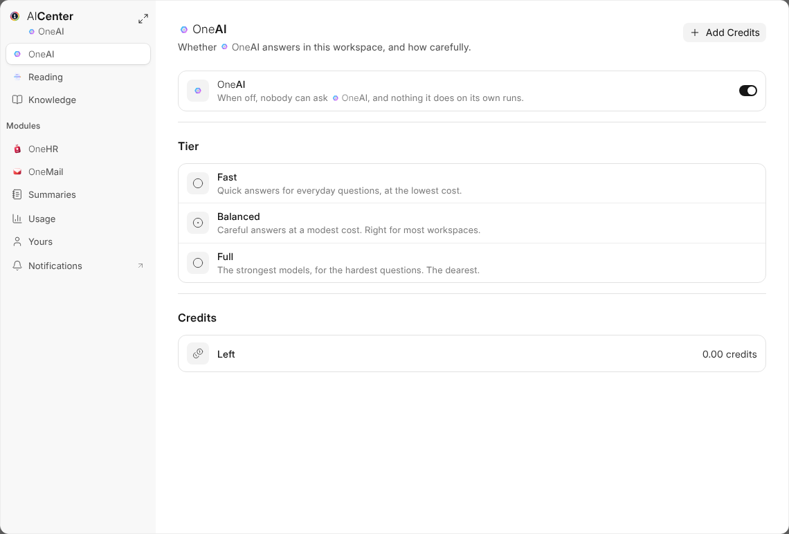

# AICenter

Everything about OneAI that can be set is in **AICenter**, opened from its
row in the bottom bar, from **OneAI** in a module's settings, and from the
cog at the foot of Documents.

## What Each Tab Holds

| Tab | What it sets |
| --- | --- |
| **OneAI** | On or off for the workspace, the tier with about what an answer costs at each, and the credits left |
| **Reading** | Reading what arrives on or off, what OneAI may do by itself, and the mailboxes and folders it reads |
| **Knowledge** | What OneAI should know about the company |
| **Modules** | What OneAI does by itself in each module, such as OneHR's screening |
| **Summaries** | Which kinds of record get a summary |
| **Usage** | The credits each job used in the last thirty days |
| **Yours** | What OneAI remembers about you |

Everybody sees **Yours**, and a role given Usage sees **Usage**. The rest is
for Workspace Administrators. Each change saves as you make it.

## For One Module

**OneAI** in a module's settings opens AICenter on that module alone; the
arrows at its corner open the whole of it.
