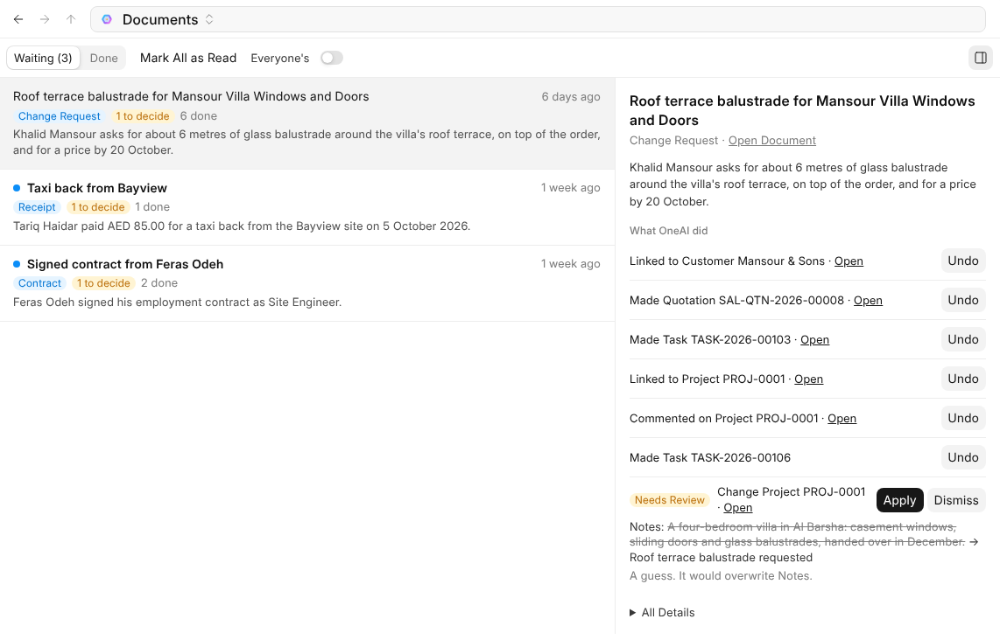

# Reading What Arrives

{one_ai} reads the mail and files that arrive in a mailbox or folder you let it
read, files each one with the record it belongs to, and makes what it asks
for: a draft bill from an invoice, a lead from an enquiry, a leave request
from a sick note.

## Letting {one_ai} Read

| What | Where it is switched on |
| --- | --- |
| A mailbox | {one_mail}'s **Settings**, the mailbox, then **{one_ai}** |
| A folder | AICenter's **What It Reads**, then **Add Folder** |
| Every mailbox and folder at once | [AICenter](settings) under **Reading**, for an administrator |

{one_ai} only does what the person who switched it on may do. Only you can
switch it on for your own files and your own mailbox. A folder {one_ai} reads
shows the {one_ai} mark.

## What Happens to a Document

1. It is read: its type, who it is from, its number, date, amount and what
   it asks. Every amount, date and number is checked against its text, and
   anything not there is left out and the reading marked **Unsure**.
2. It is filed with the record it is about, or in a folder for its type and
   year, and renamed so it can be found.
3. What it asks for is made, as a draft. {one_ai} never submits, posts or sends
   anything.

Spam, phishing, advertising and newsletters are recognised from a quick look
and never read in full. Phishing is reported to the person {one_ai} reads for.

> **A document that tells {one_ai} what to do is not obeyed.** What reads like
> instructions to {one_ai} waits for a person instead.

## Documents

**Documents**, first in {one_ai}'s rail, has two boxes:

| Box | What is in it |
| --- | --- |
| **Waiting** | What needs your decision, with **Apply** and **Dismiss** |
| **Done** | Everything {one_ai} handled, with what it made and changed, and **Undo** |

Click a line to read it on the right: what {one_ai} understood, **All Details**,
**Open Document** and **What {one_ai} did**.

## Undo

**Undo** reverses everything {one_ai} did with a document: files go back to
their old folders and names, and records it made are deleted. Anything
somebody has since checked, changed or submitted stays, and Undo says why.
After the same correction three times for a sender, {one_ai} asks instead of
acting.

## What Waits for You

Changing a value a record already has, such as a tax number or a bank
account, waits for you, and so does anything {one_ai} is unsure of. You are told
once a document has something waiting.
