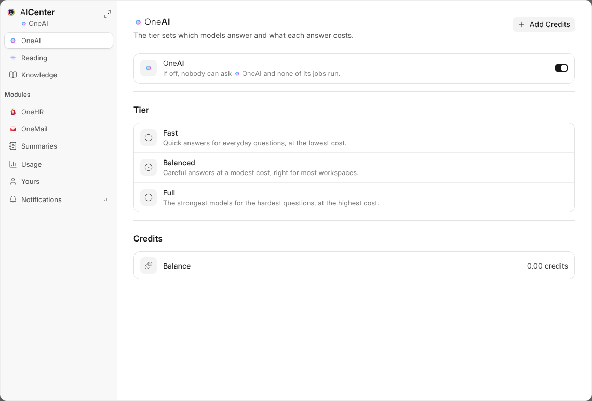

# AICenter

Everything about {one_ai} that can be set is in **AICenter**, opened from its
row on {one}'s rail, from **{one_ai}** in a module's settings, and from the cog
at the foot of Documents.

## What Each Tab Holds

| Tab | What it sets |
| --- | --- |
| **{one_ai}** | On or off for the workspace, the tier with about what an answer costs at each, and the credits left |
| **Reading** | Reading what arrives on or off, what {one_ai} may do by itself, and the mailboxes and folders it reads |
| **Knowledge** | What {one_ai} should know about the company |
| **Apps** | What {one_ai} does by itself in each app, such as {one_hr}'s screening, and its buttons there, such as Write My Bio, each of which can be turned off |
| **Summaries** | Which kinds of record get a summary |
| **Usage** | The credits each job used in the last thirty days |
| **Memory** | What {one_ai} remembers about you |
| **What It Reads** | Your mailboxes and folders {one_ai} reads, files and acts on as you |

Everybody sees **Memory** and **What It Reads**, under **Yours**, and a role given Usage sees **Usage**. The rest is
for Workspace Administrators. Each change saves as you make it.

## For One Module

**{one_ai}** in a module's settings opens AICenter on that module alone;
**AICenter** on {one}'s rail opens the whole of it. The arrows by its name make
the window larger, as on every centre.
