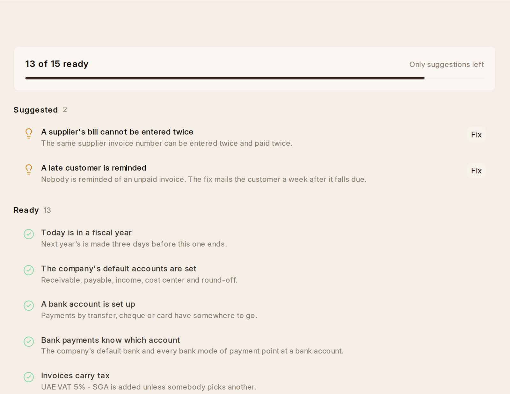

# Getting Ready

**Setup › Books Check** lists what would stop the first invoice, payment or
bill, and says **Ready**, **To Do** or **Suggested** beside each, with a
**Fix** button where there is one for somebody who may make the fix (Who Can
Do What):

- **A bank account is set up.** **Fix** asks for the bank's name and the
  account's, and makes the account in the chart, the company's bank account,
  and connects every bank mode of payment — Wire Transfer, Cheque, Credit Card
  — to it. A bank account added any other way is connected the same way.
- **Invoices carry tax** and **Bills carry tax.** **Fix** asks which tax
  template is added to a new invoice or bill when nobody picks one, in a
  form and on every invoice or bill One, OneAI or an import makes.
- **A late customer is reminded.** **Fix** turns the payment reminder on.
- **Opening balances are finished.** Opening invoices and opening stock are
  posted against Temporary Opening; once every opening balance is in,
  an accountant moves what it holds to capital with a Journal Entry. Until
  then the Balance Sheet carries it, and the check says how much.
- **Every year that has ended is closed.** **Fix** closes the year (below).
- In the UAE: **the VAT return knows the VAT accounts**, **bills claim
  their VAT back**, **invoices carry the company's TRN** and **the company's
  emirate is known**. **Fix** fills the first from the chart, the second
  from each bill's own VAT, and asks for the other two.
- **A supplier's bill cannot be entered twice.** **Fix** turns on the check
  that refuses the same supplier invoice number a second time.
- **Today is in a fiscal year** and **the company's default accounts are
  set** — both are made with the company, and the check catches a workspace
  where they were not.

## Opening Balances

When the books start part way through a business's life, what customers
owed and what was owed to suppliers on that day goes in once, from **Home ›
Setup › Opening Invoice Creation Tool** (an Accounts Manager's):

1. Pick the **Invoice Type**: Sales for what customers owe, Purchase for what
   you owe suppliers.
2. Add a row per invoice still open: the party, the **Outstanding Amount**,
   and its **Posting Date** and **Due Date**. **Create Missing Party** makes a
   customer or supplier that is not there yet.
3. **Create Invoices** makes them as opening invoices, which count in
   Accounts Receivable and Accounts Payable like any other.

The bank's and every other account's opening balance is a **Journal Entry**
(below). When all of it is in, the Books Check's **Opening balances are
finished** says what is left in Temporary Opening to move to capital.
