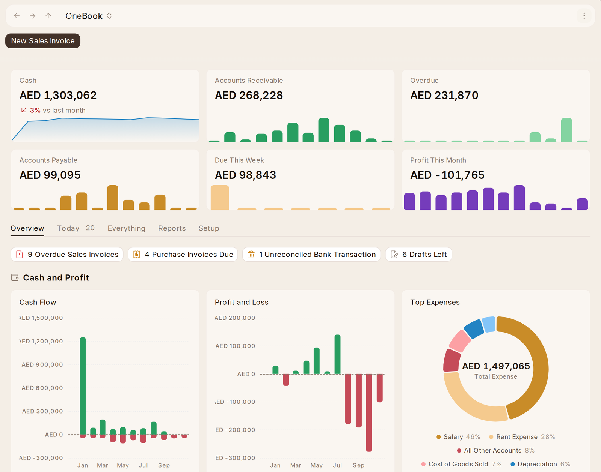

# Home

Six figures say where the money stands, each with its last twelve months
drawn small under it:

- **Cash** — what is in the bank and cash accounts, against last month.
- **Accounts Receivable** — what customers still owe, and **Overdue** — the
  part of it past its due date.
- **Accounts Payable** — what is still to pay suppliers, and **Due This
  Week** — the part due in the next seven days, including any already late.
  Overdue is drawn by the month each part fell due, and Due This Week by the
  day.
- **Profit This Month** — income less expenses since the first of the month,
  against last month.

Click a figure to open the report or list it came from: Due This Week opens
the bills due by the week's end. A change against last month is not shown on
a loss, where a percentage would read the wrong way. Under them are five
tabs:

- **Overview** — what needs doing as a row of buttons, then the money told in
  charts: **Cash Flow** (what came into
  and went out of the bank and cash accounts each month), **Profit and Loss**
  (each month's profit or loss) and **Top Expenses** (the five largest expense
  accounts and the rest); then, for **Accounts Receivable** and **Accounts
  Payable** each, the **Ageing** of what is owed by how late it is, who owes
  or is owed the most, and the year's invoices by status. Click a chart to
  open what it was drawn from.
- **Today** — overdue sales invoices, purchase invoices due this week or
  already late, unreconciled bank transactions by bank account, and drafts
  left more than a day, each row opening its document.
- **Everything** — every accounting screen, each by its own name and with a
  line on what it is for, with a search.
- **Reports** and **Setup** — their part of Everything, by topic.

Setup has every accounting setting, a country's own only when the company is
there. Among them: the **Email Digest**, a mail each day, week
or month of how the business is doing; **Plaid Settings**, for a bank Plaid
reaches; and the **Code Lists** an electronic invoice names its units and
taxes by.
