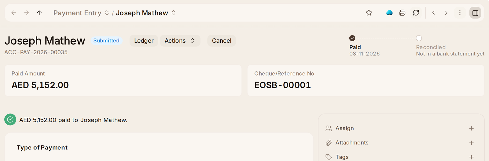

# Payments

**Record Payment** on an invoice is the quick way. For anything else —
money on account, a payment across several invoices, a refund, moving money
between two of the company's accounts — use **Payment Entry › + Add Payment
Entry**:

1. Pick the **Payment Type**: **Receive**, **Pay** or **Internal Transfer**.
2. Pick the party (customer, supplier or employee), the **Mode of Payment**
   and the **Paid Amount**, and the bank's reference in **Cheque/Reference
   No**.
3. **Get Outstanding Invoices** lists what the party still owes or is owed,
   to settle with it.
4. **Submit.**

A payment says who it was to or from in its title. At the top are the
**Paid Amount**, the **Mode of Payment**, the bank's reference and the
**Project** it is for, and, once it went through a bank account, a track to
**Reconciled** once it is matched to the bank statement.
