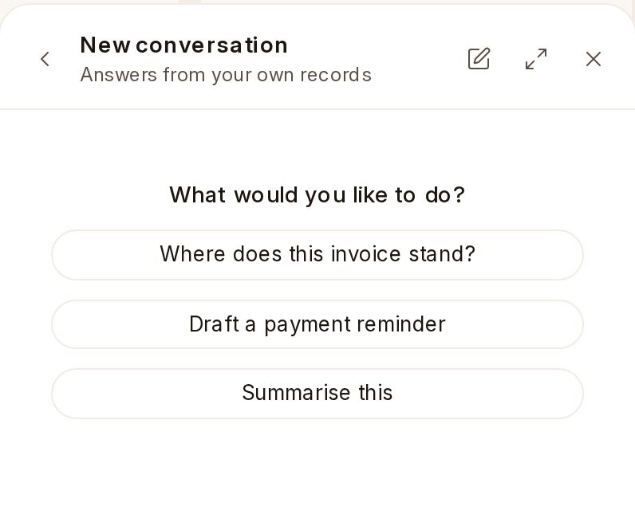

# Asking {one_ai}

Open {one_ai} on a page and it offers what makes sense there. It reads the books
as you may see them and never posts, pays or changes anything in them.

- **On Home**: *How is the money doing?* says what is in the bank, what
  customers owe and how much is late, what is owed and falls due this week,
  and how profit went. *Who owes us the most, and how late?* and *What do we
  have to pay this week?* list the invoices behind them.
- **On a Sales Invoice**: *Where does this invoice stand?* says what is still
  owed, what is late, and the payments and credit notes that settled the rest.
  *Draft a payment reminder* writes a short, polite email for you to send.
  On the list, *Which invoices are overdue?*
- **On a Purchase Invoice**: *What do we have to pay this week?* on the list,
  and *Where does this invoice stand?* on one.
- **On a Customer**: *What do they owe, and how late?*
- **On Bank Transaction**: *Which bank lines are still to match?*
