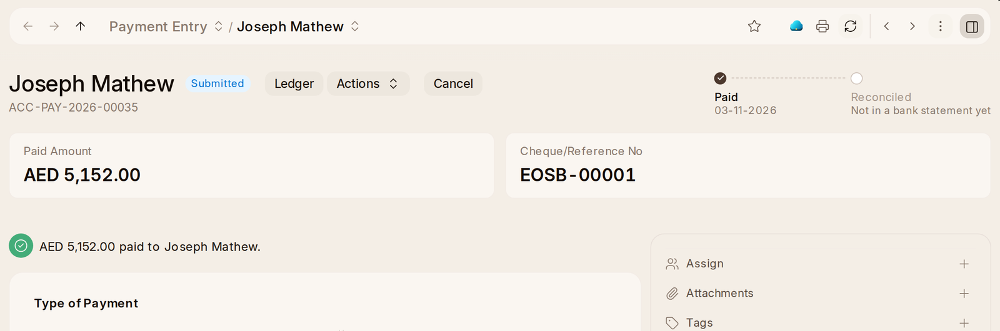

# Payments

**Record Payment** on an invoice is the quick way. For anything else —
money on account, a payment across several invoices, a refund, moving money
between two of the company's accounts — use **Payment Entry › + Add Payment
Entry**:

1. Pick the **Payment Type**: **Receive**, **Pay** or **Internal Transfer**.
2. Pick the party (customer, supplier or employee), the **Mode of Payment**
   and the **Paid Amount**, and the bank's reference in **Cheque/Reference
   No**.
3. **Get Outstanding Invoices** lists what the party still owes or is owed,
   to settle with it.
4. **Submit.**

A payment says who it was to or from in its title. At the top are the
**Paid Amount**, the **Mode of Payment**, the bank's reference and the
**Project** it is for, and, once it went through a bank account, a track to
**Reconciled** once it is matched to the bank statement.

## A second person approves

Some payments out wait for a second person before they go. You save the
payment as usual; **Submit** then says it waits, and who was asked.

| A payment waits when | Set in |
| --- | --- |
| It is above the company's limit, in the company's currency | **Payment Approval Limit** |
| It is the first payment to a supplier or customer | **Require Approval of First Payments** |
| The party's bank details changed in the last days | **Approval After Bank Change (Days)** |

The three are in [Settings](settings), under **Payment Approval**, for each
company. An accounts manager or an administrator who didn't make the payment
opens it from **Home** or the notification and presses **Approve Payment**,
which submits it, or **Refuse**. You're told either way.

## Changed Bank Details

When somebody changes the bank details a supplier, customer or employee is
paid into, nothing is paid to them until a second person presses **Approve
Bank Details**. The supplier or customer is mailed at the address on their
record, and an employee is told on their bell, so a change nobody asked for
is noticed. A party's first bank account waits for nothing.

> Where nobody else can approve, such as a workspace with one administrator
> who also keeps the books, you approve your own, and you have to say why.
> The approval keeps what you wrote.
