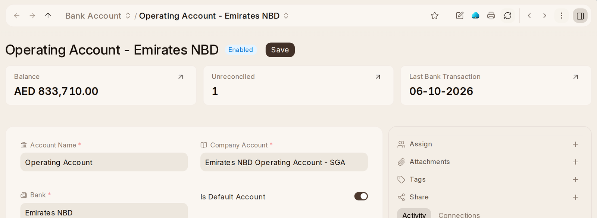

# Matching the Bank

Each line of a bank statement is a **Bank Transaction**. To bring a
statement in:

1. **Banking › Bank Statement Import › + Add.** The company's default bank
   account is filled in.
2. Save, then attach the bank's file under **Import File** (**Download
   Template** gives a spreadsheet to fill when the bank's file will not do).
3. Check the preview and press **Start Import**.

A statement {one_ai} reads from mail arrives as Bank Transactions the same
way.

To match them, open **Bank Reconciliation Tool**. It starts on the default
bank account; pick the dates and type the **Closing Balance as per Bank
Statement**, then press **Get Unreconciled Entries**. Each line has
**Actions**:

- **Match Against Voucher** — the payment or journal entry already in the
  books for it.
- **Create Voucher** — a new Payment Entry or Journal Entry for it, such as
  a bank charge.
- **Update Bank Transaction** — correct the line's reference or party.

The figures at the top compare the statement's closing balance with the
books' and show the **Difference**, which is nought once everything is
matched. **Auto Reconcile** matches the lines whose payment it can find by
their reference and amount, and leaves the rest to you.

A **Bank Transaction Rule** (Home › Setup) matches a bank line by its
description, such as DEWA's direct debit to Utility Expenses, so it is not
asked about each month. A bank account's page says what the books hold in it
and how many lines are still to match.
