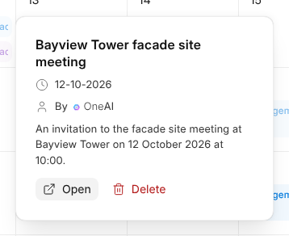

# Making Events

**New Event**, or dragging across the hours, opens a short form: the
subject, when it starts and ends, where, who to invite and a description.

- **Invite** adds people in the workspace. Each is told and finds it on their calendar.
- **Guests** takes the email addresses of people outside the workspace. Each is mailed an invitation for their own calendar, and again if the event moves or is cancelled.

## An Event's Card

Click an event to see when it is, where, who made it, who's invited and
their replies, and its description. **Open** shows the event's page, and
**Delete** cancels it for everyone if you made it. Reminders, repeats and
who is invited are changed on the event's page.

## Moving Things

- Drag an event you made to another time, or drag its bottom edge to change how long it is.
- Drag a task to another day to change its due date.
- A repeating event is changed from its own page, for every time it happens.

## Who Sees an Event

- A **private** event is seen by whoever made it, the people invited, and anybody it is shared with.
- An event **about a record**, such as a deal, a lead or an employee, is also on the calendar of everybody who may open that record, under Company Events. Clicking it opens the record, and only whoever made it can change it.
- An event **on everyone's calendar** is seen by the whole workspace. Only an administrator, or whoever holds **Put Events on Everyone's Calendar**, can make one. See [Who Can Do What](who-can-do-what).

A maintenance visit booked from a maintenance schedule is named for the visit
and the customer.
