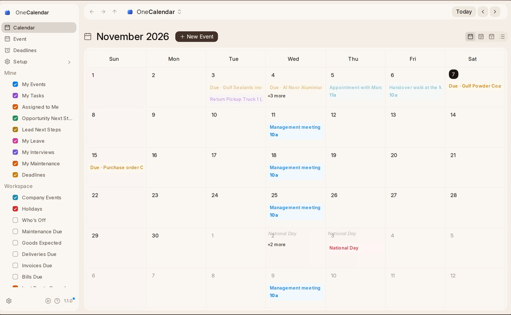

# What OneCalendar Is

OneCalendar shows everything dated in One on one calendar: your meetings,
tasks, deals' next steps, leave, interviews, deadlines, the company's
holidays and who's off. Each kind is a calendar of its own that you show or
hide. Nothing is copied into it: a deal's next step belongs to the deal, and
moves when the deal changes.

## Finding Your Way

| You see | What it is |
| --- | --- |
| **The rail**, on the left | **Calendar**, **Event** (every event as a list), **Deadlines**, and **Setup** for those with access. Under them, your calendars, in **Mine** and **Workspace**. See [Your Calendars](calendars). |
| **The buttons**, over the calendar | **New Event**, then **Today**, the arrows and the date, which opens a picker. **Month**, **Week**, **Day** and **List** are at the right. |
| **The calendar** | Your events and everything else dated, in each calendar's colour. The workspace's weekly days off are lightly shaded, and holidays show in red with their names. |
| **The foot** | **Settings**, the play button that takes the tour, the question mark that opens this Help, and OneCalendar's version, which opens What's New. |

The calendar opens on your last view and the calendars you chose, on any
computer. On a phone it opens on the day instead of the week. A new event or a moved task elsewhere appears without reloading.

A short tour shows you each of these: press the play button at the foot of
the rail.
