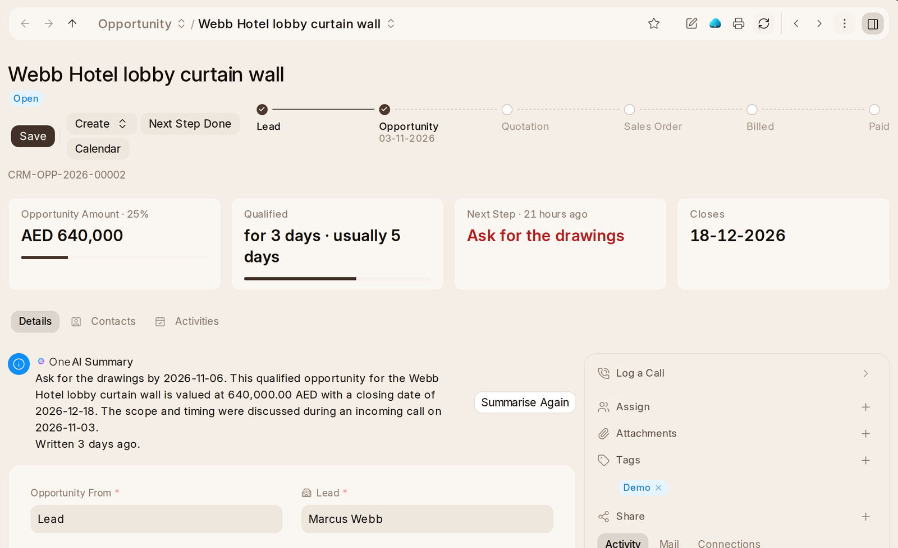

# A Lead's Page

An opportunity's page says first where the sale stands, in a line and a
track: quoted, ordered, billed and paid, as the quotation, the sales order and
the sales invoices made from it say. The line says what the track cannot:
lost and why, on hold, a quotation still with them or run out, or won and
how much of it is still owed — red once some of that is late. Won and lost
opportunities say the day they were won or lost rather than a time in a stage.

The figures under the name answer what the page is usually opened for, before
anything is clicked:

- on an opportunity — **Opportunity Amount** and its probability, the
  **stage** and how long it has been there beside how long opportunities
  usually stay there (amber once it is longer, and more than a day), the
  **Next Step** (red once overdue), and when it **Closes** (red once past);
- on a lead — the **Next Step**, **Waiting For a Reply** or how long the
  **First Reply** took, the last call or email, and the **Opportunities** made
  from it.

Where it came from is its **Source**, and its latest quotation is on the track.

A lead or opportunity nobody owns yet offers **Take This Lead** (or Opportunity), which
makes it yours.

A lead or opportunity that is closed — converted, won or lost — shows no next step
and no waiting.

Each answer that comes from another record opens it.

**Log a Call** in the sidebar writes a call down: outgoing or incoming,
answered, no answer or busy, how long, and what was said. It goes on the
timeline beside the mail and the comments, and counts as the last contact.

**Everything said is on one timeline**, under Activity in the panel beside the
record: comments, calls, mail sent and received, stage changes and every edit.
Write a note in the comment box there; notes are comments. The record's own
Activities tab keeps the open tasks and events, with New Task and New Event.
An opportunity made from a lead brings the lead's comments and mail with it
(CRM Settings).
