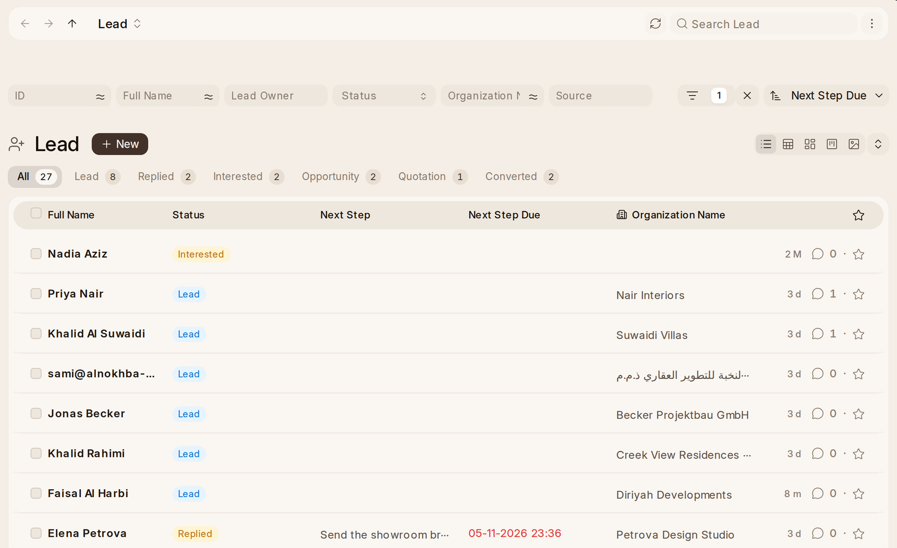

# From Lead to Sale

A **Lead** is where a sale usually starts. From a lead, **Create** makes an
opportunity, a quotation, a customer or a prospect, and whatever was written on the
lead goes with it.

An **Opportunity** is a sale in progress. Its **Sales Stage** says how far it has got,
and a quotation made from it is linked back to it. **Opportunity Amount** is what it is
worth; an opportunity priced by its items takes their total when no value is typed.

Every screen says Opportunity, so Ctrl+K finds it by the word on the rail.

## Converting a Lead

Open the lead and use **Create**:

- **Opportunity** — they want something you can price. The opportunity
  takes the lead's details, comments and mail, and the lead's status
  becomes Opportunity.
- **Quotation** — straight to a price, without an opportunity.
- **Customer** — they have bought, or are about to. The lead's status
  becomes **Converted**, and it shows no next step from then on.
- **Prospect** — the business behind the lead, when you want to sell to the
  business rather than one person (see Customers and prospects below).

An opportunity's own **Create › Customer** turns whoever it is with into a
customer, and **Create › Quotation** prices it.

## How Leads Come in

A lead can be made three ways:

- **At the desk**, from the Lead list or **New Lead** on Home.
- **From the website.** The **Get in Touch** form at /get-in-touch asks for a
  name, business, email, mobile and a message, and makes a lead with its
  source set to Website and the message kept on it. Change the form under
  **Setup › Get in Touch Form**; link to it from your own website.
- **From an inbox.** OneAI reads the workspace's mail, and an enquiry
  from somebody new comes with a lead ready to make. Mail from somebody who
  is already a lead is linked to their lead instead.

A lead from the website or an inbox belongs to nobody at first. It waits on
Home under **Unclaimed Leads** until somebody presses **Take This Lead**, or an
**Assignment Rule** shares it out: set one up under **Setup › Assignment Rule**
(round robin or by load) and the person it picks becomes the Lead Owner. A
Sales Manager keeps these rules. A rule of theirs is on a lead or an opportunity, and
says which ones it takes by comparing the record's fields with plain values,
such as Source is Website, never by code.

**Somebody who is already a lead is not made twice.** At the desk, a second
lead with the same email is refused with a link to the first. From the website
it is made but marked **Possible Duplicate Of** the first, and a lead whose
phone number or business name matches another lead or a customer is marked the
same way. The page says so at the top and offers **Merge Into …**, which moves
its comments, mail, calls and opportunities across and deletes it, or **Not a
Duplicate**. Phone numbers match however they were typed: +971 50 123 4567
and 050-1234567 are one number.

**The first reply is timed.** A lead's page shows **Waiting For a Reply** and
for how long until the first mail is sent or call is made to them, and then
**First Reply** and how long it took.
