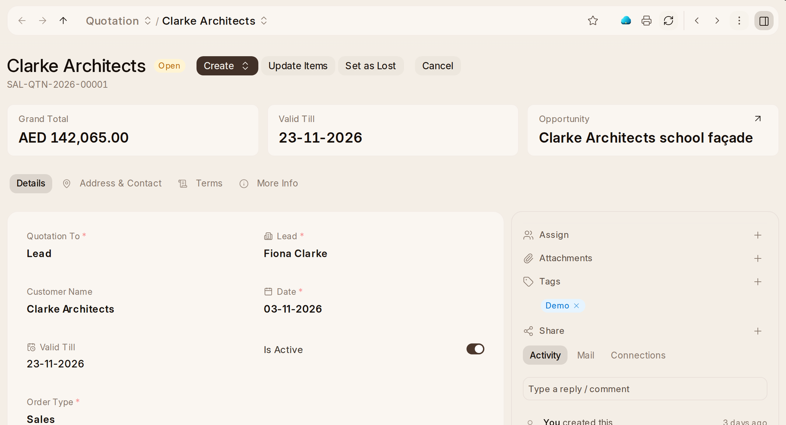

# Quoting and the Order

1. On the opportunity, **Create › Quotation**. Add the items with their
   quantity and rate, and set **Valid Till**, the last day the customer may
   accept it.
2. **Submit** it, then **Print** (One Quotation, with room for both sides to
   sign) or send it.
3. To let the customer answer online, press **Portal** on the quotation and
   **Send Link** to one of their contacts. They open it without an account
   and accept or decline it once. Accepting asks the date they need it by
   and their own reference.
4. An acceptance makes a draft **Sales Order** from the quotation and tells
   whoever made the quotation and the opportunity's owner (**Quotation
   Accepted**). Check the order and **Submit** it. A quotation the customer
   agreed to some other way becomes an order with **Create › Sales Order**.
5. A declined quotation is marked lost with their reason (**Quotation
   Declined**). To mark one lost yourself, **Set as Lost** asks why.

The opportunity's track then moves on to ordered, billed and paid on its
own. OneInventory delivers the order (**Create › Delivery Note**) and
OneBook invoices it (**Create › Sales Invoice**). A quotation still open
three days before its Valid Till is told as **Quotation Running Out**.
