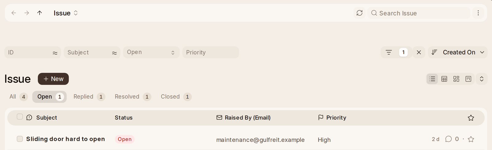

# Support

**Support** in the rail is the service desk. An **Issue** is a
customer's complaint or question until it is resolved, timed against the
service level agreement. A **Warranty Claim** is something sold that broke;
**Make Maintenance Visit** on it sends somebody. A **Maintenance Schedule**
promises a customer visits over a year, and each **Maintenance Visit**
records the work done; a visit prints as a **Service Report** the customer
signs, and a schedule as a **Maintenance Plan**. Issue's own reports are
under Reports' Support.

