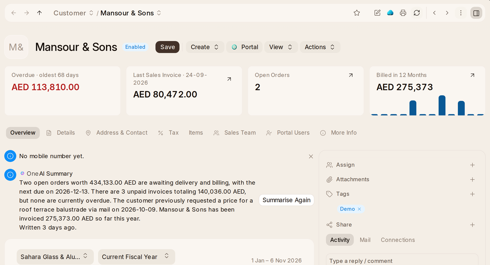

# Customers and Prospects

A **Customer** is a business or person who buys from you. Their page says
what they owe and how much of it is late, what they were billed this year,
their last invoice, their open orders, and their open opportunities with
what they are worth. **Print** gives their Statement of Account. Customers
are kept here and used by {one_book}, {one_inventory} and {one_project} alike.

A **Prospect** is a business you want to sell to before it has bought
anything. Its page gathers its leads and opportunities in one place. Its
people are contacts in {one}'s **Address Book**.

To let a customer's contact sign in and see their own quotations, orders and
invoices, open the contact and choose **Portal › Invite to Portal**. A Sales
Manager or the workspace administrator may invite.
