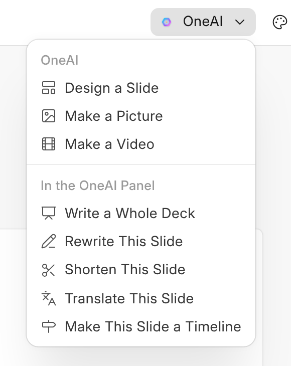

# Asking OneAI

When OneAI is on, **OneAI** in the head makes three things from a sentence.
Nothing it makes is kept until it is on your slide, and each request uses
credits like any other.

| Ask | What happens |
| --- | --- |
| **Design a Slide** | A new slide after the one you are on, laid out in your business's colour. Everything on it can be changed like anything else. |
| **Make a Picture** | A picture on this slide. |
| **Make a Video** | Takes a few minutes. It arrives on a new slide at the end, and you are told when it is there, or that it could not be made. |

## Decks in the Panel

The rest of the menu opens OneAI's panel, which knows the presentation and
the slide you are on. **Write a Whole Deck** asks what it is for; OneAI
reads the record the presentation is filed on, and anything else it needs,
and shows the slides it would write as a card: each one's kind and title.
Nothing changes until you press **Approve**. It builds them from One's
kinds of slide in your business's colour, and puts a value from a record in
as a field that stays up to date rather than typing the number.

**Rewrite This Slide**, **Shorten This Slide**, **Translate This Slide** and
**Make This Slide a Timeline** work the same way on the slide that is open:
a card first, the change after you approve it. You can ask in your own
words in the panel too, such as "make the third slide figures". Before
OneAI changes slides, what they were is kept in **Version History**.

**Make a Picture with OneAI** is in OneWriter too, in the menu that adds a
picture to a document.

An administrator can turn OneAI off for OneDeck in AICenter.
