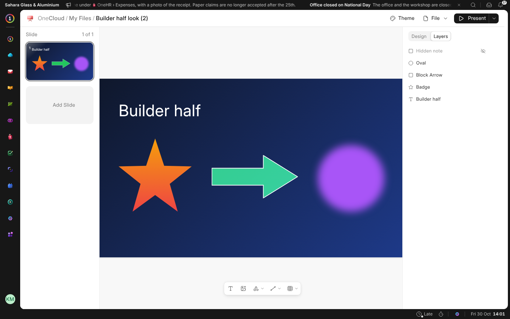
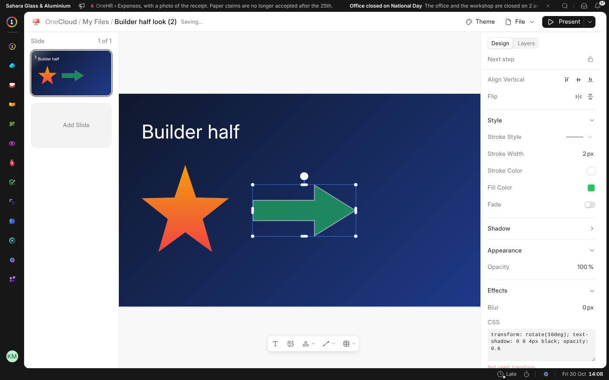
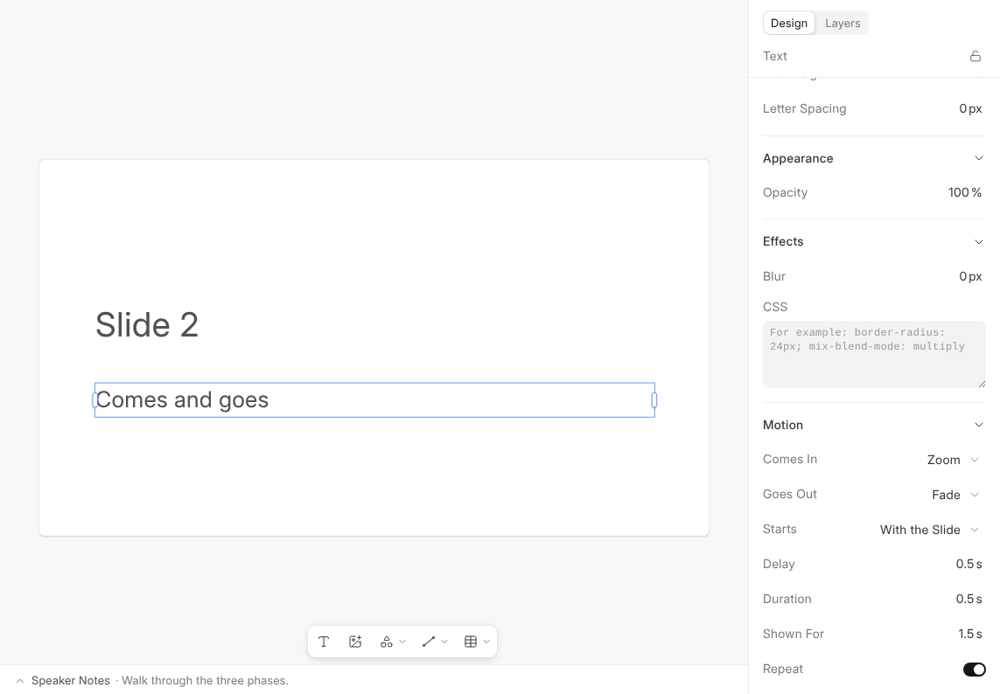

# Design and Layers

The panel has two tabs at the top: **Design**, for whatever you chose, and
**Layers**, for everything on the slide.

## Layers

**Layers** lists what is on the slide, the top first. Click one to choose
it, double-click it to give it a name, and drag it up or down to put it in
front of or behind the others. Its eye hides it and its lock keeps it from
being moved. A hidden element is not shown in the editor, the slideshow or a
PDF.

## Fades

Any fill, and a slide's background, can **Fade** into a second colour. Turn
on **Fade**, then choose the colour it fades to and the angle it runs at.

## Effects

**Effects** blurs anything. Its **CSS** box takes CSS for the rest: rounded
corners, blend modes, text shadows, clip paths. What the box can't use is
listed under it as **Not used**. Where an element stands, its size and its
turn always come from the panel above.

## Things That Come and Go

Anything on a slide can come in after the slide does, and go again. Choose
it, and under **Motion** in the panel:

| Setting | What it does |
| --- | --- |
| **Comes In** | Fade, Fly In, Zoom or Rise, or None to be there from the start. |
| **Goes Out** | Fade, Fly Out, Zoom or Sink, or None to stay. |
| **Direction** | The side it flies in from, or out to. |
| **Starts** | With the slide, or **On Click**: the next click, key or phone tap brings it in before the next slide comes. |
| **Delay**, **Duration** | How long it waits before it moves, and how long the move takes. |
| **Shown For** and **Repeat** | How long it stays before it goes out, and whether it then comes back and goes again for as long as the slide is up. |

The presenter view's **Next**, the phone remote and someone browsing a shared
link step through what comes on a click the same way. Whoever follows you
live, and a screen in OneDisplay, has nobody clicking, so what waits for a
click comes a moment after the one before it.
