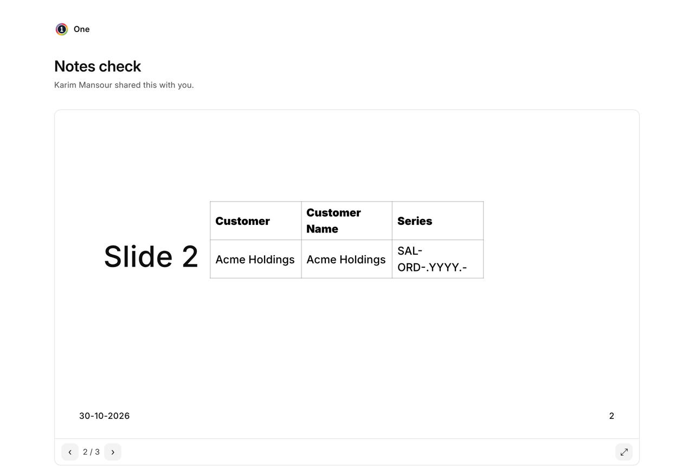
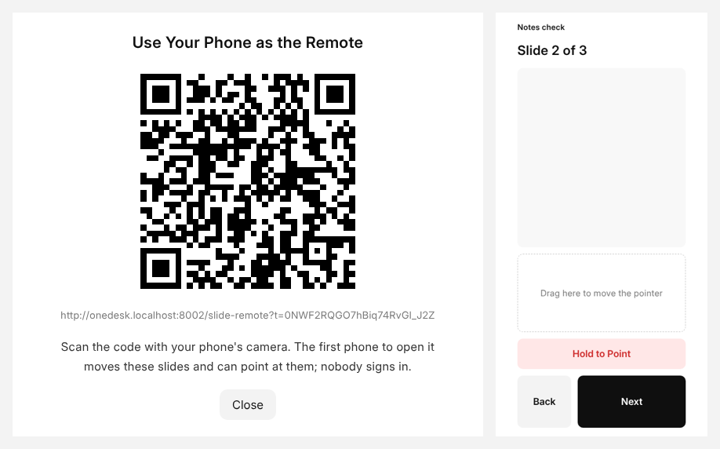

# Presenting by Link

Share a presentation with a link from **File › Share…** in the editor, or
from OneCloud as you would any file: to
anyone with the link, with a password, or to people you invite, who come in
with a code sent to them. Whoever opens the link sees the slides on the
page, not a file to download. They move with the arrows or by clicking the
slide, and **⤢** fills their screen.

Words that come from your records are shown as you see them, so somebody on
the link never reaches the records themselves. If the link allows
downloading, **Download as PowerPoint** gives them a copy.

## In a Meeting Room

Nobody has to sign in on the room's computer. Open the link there and click
**Phone Remote**: the slides fill the screen and show a code. Scan it with
your phone's camera, and the phone becomes the remote for that screen, with
**Next**, **Back** and **Hold to Point**, as in the presenter view.

The first phone to open the code keeps it, so anybody else in the room who
scans it is told another phone is already the remote. If you are signed in
on your phone and may open the presentation, the phone shows your notes too.
The remote ends when the page is closed, or when the link is turned off;
clicking **Phone Remote** again shows a new code for another phone.

## Present Live

**Present ▾ › Present Live** plays the presentation, and everyone who has
it open through a link follows your slides as you move. Someone who goes
their own way gets **Follow the Presenter** to come back. It ends when your
slideshow ends.

In the presenter view, **Present Live** does the same for the slides you
move there, from the keyboard or from your phone, and **Stop Presenting
Live** or ending the presentation stops it.

## Views

**File › Views** shows each time someone opened the presentation through a
link: who, if they were invited, when, and for how long, and how long each
slide held them, added up. Only people who may change the presentation see
it.
