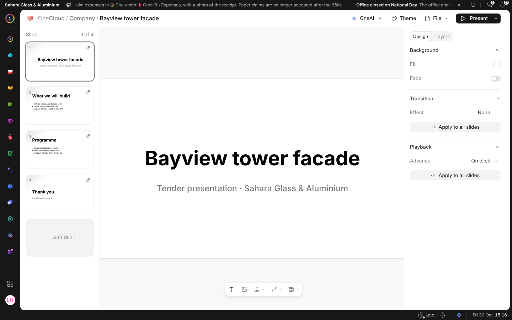

# What {one_deck} Is

{one_deck} makes presentations: a tender pitch, a monthly review, a training
session. A presentation is a file in {one_cloud}, kept
beside everything else the business has, and opened by anybody it is shared
with.

## A New Presentation

**New › Presentation** in {one_cloud} makes one in the folder you are in and
opens it on its title slide. It asks which template to start from and how
big the slides are: wide like a screen, 4:3, A4 standing or lying down,
square, standing like a phone, or a size of your own. **File › Slide Size**
changes it later, and everything on every slide is redrawn to fit. Click a presentation in {one_cloud} to open it
again. It saves itself as you work: the head says **Saving…** and then
**Saved**.

The path at the top says where the presentation is kept, and each step is a
way back. Click its name there to rename it.

## Finding Your Way

| You see | What it is |
| --- | --- |
| **The slides** | Down the left. See [Working on Slides](working-on-slides). |
| **The bar under the slide** | Text, pictures and videos, shapes, lines and tables. |
| **The panel** | On the right: whatever you chose, or the slide itself. See [Design and Layers](design-and-layers). |
| **File** | Version History, Save as Template, Export as PDF or PowerPoint, Slide Size, Edit Master, and the rulers. See [History, Templates and Files](history-and-pdf). |
| **{one_ai}** | Designs a slide, or makes a picture or a video. See [Asking {one_ai}](asking-oneai). |
| **Present** | Plays the presentation from this slide or from the start. |

{one_display} can play a presentation on a TV too; its own Help says how.
