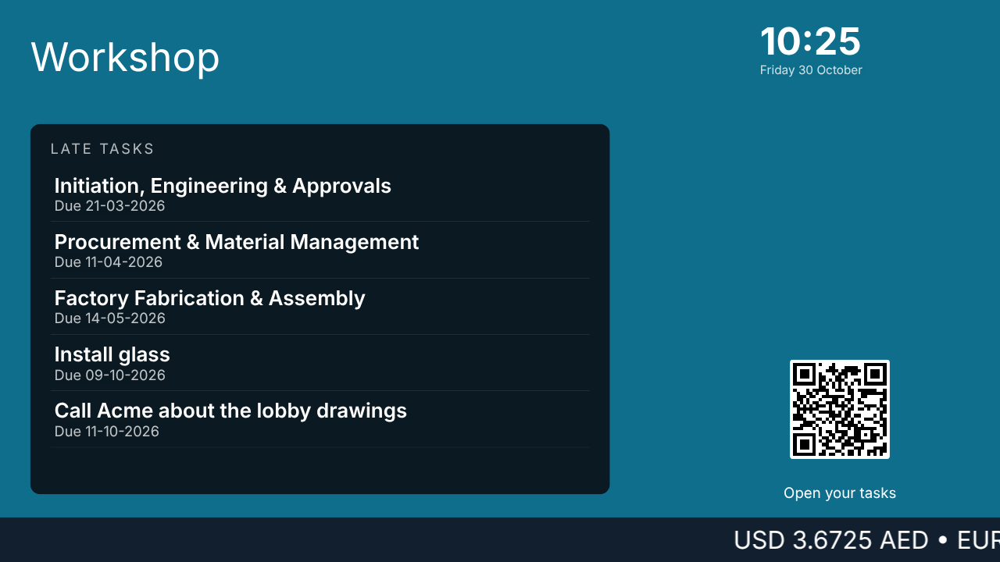

# What OneDisplay Is

OneDisplay puts what your business wants people to see on any screen with a
web browser: a TV in the lobby, a kiosk at the door, a display behind a
counter. Each screen plays a **channel**: slides, a layout of live widgets
such as a queue board, a clock or the weather, music, and spoken ads, on a
schedule you set. Every screen showing the same channel shows the same slide
at the same moment.

## Finding Your Way

| You see | What it is |
| --- | --- |
| **Display Screen** | Every screen you paired, and whether it is online, turned off or waiting to pair. See [Adding a Screen](screens-and-pairing). |
| **Display Channel** | What a screen plays, and when. See [Channels and Schedules](channels). |
| **Counter** | Where whoever serves a queue calls the next ticket. See [Queues and Tickets](queues). |
| **Content** | The slides, widget layouts, music and spoken ads a channel plays, and the sources that fill widgets with your records. |
| **Queues** | Each queue with its services and counters, and every ticket taken. |
| **The foot** | **Settings**, the play button that takes the tour, the question mark that opens this Help, and OneDisplay's version, which opens What's New. |

## What a Screen Needs

A screen needs a browser and a connection. Most smart TVs have a browser, and
a small stick or box behind any screen does the same. A screen that loses its
connection keeps playing what it last had, and catches up when it is back.

A short tour shows you around: press the play button at the foot of the
rail.
