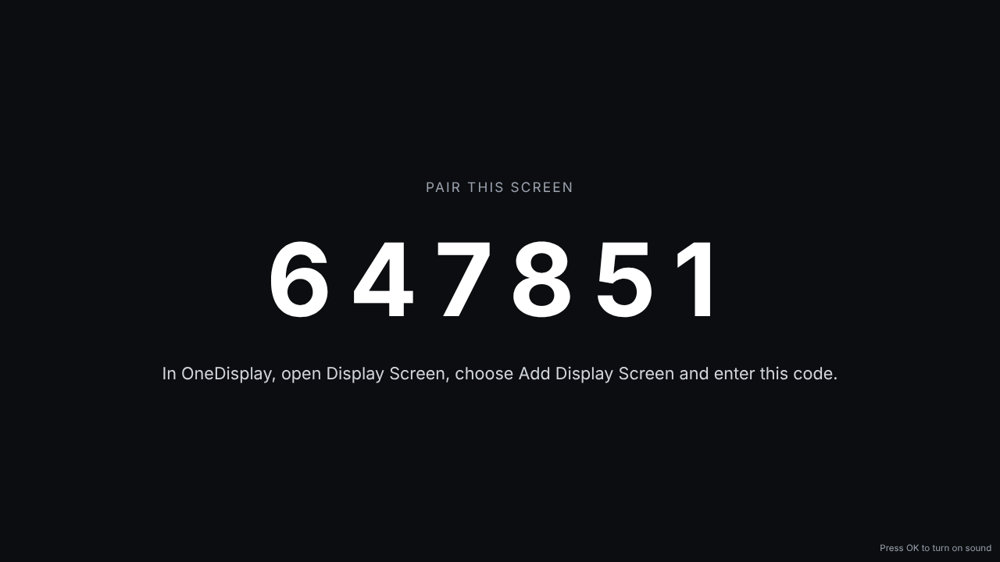

# Adding a Screen

A screen is added from the screen itself, so nobody has to type a password
on a TV remote.

1. On the screen, open your workspace's address followed by `/tv`. It shows
   a six-digit code.

   

2. In OneDisplay, open **Display Screen** and press **Add Display Screen**.
3. Type the code, name the screen, choose its channel and say how it is hung.
   The screen starts playing within a few seconds.

The screen remembers it was added, through power cuts and restarts. Deleting
it here sends it back to showing a code.

## Turned or Upside Down

A screen hung on its side, or upside down, is set with **Turn** when you add
it, or on the screen's record later. The picture is turned to stand upright,
and a channel made for a tall screen fills it.

## Controlling a Screen

Open a screen to see when it was last seen. Under **Screen** you can:

| Button | What it does |
| --- | --- |
| **Reload** | Starts the screen's page again, as if it were switched off and on. |
| **Mute** and **Unmute** | Silences its music, ads and calls, or brings them back. |
| **Turn Off** and **Turn On** | Makes it black, or brings it back. A screen turned off is not reported offline. |

The screen hears it within a second or so. A change to its channel, its
slides or its widgets reaches it just as fast; a screen whose connection
cannot keep that up asks every few seconds instead.

## Sound on a New Screen

Browsers keep sound off until somebody presses a key. A new screen says so
across the bottom; press OK on the remote once, and it remembers.
