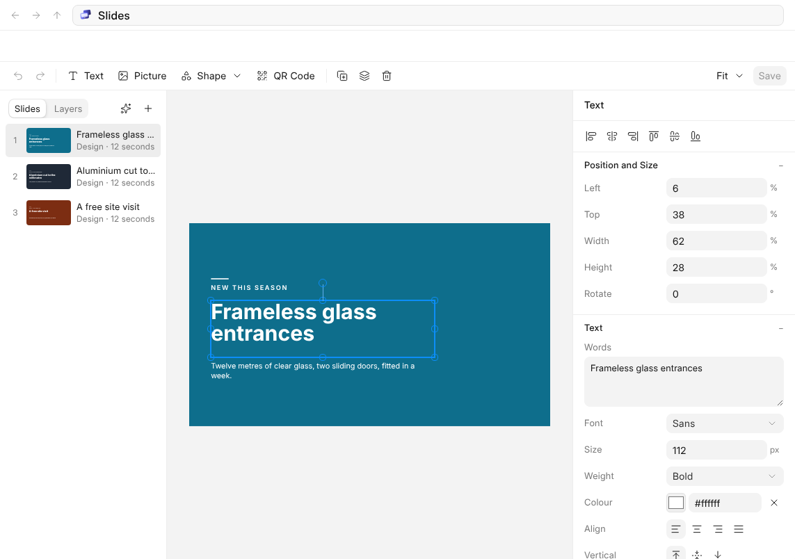
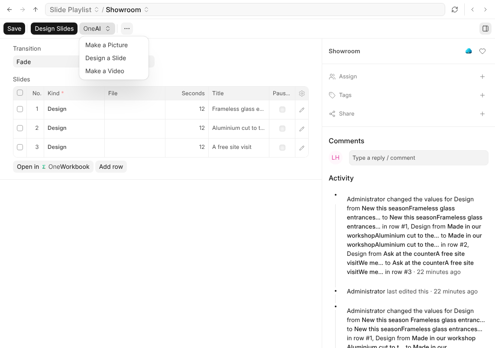

# Slides

A slide playlist is a list of slides, each shown for its own number of
seconds, one after the other, over and over.

| A slide can be | What it is |
| --- | --- |
| **Image** | A picture, filling the screen or fitted inside it. |
| **Video** | A video, shown for as long as it runs. |
| **Web Page** | Any page that allows being shown inside another. |
| **Design** | A slide drawn for the screen, with your words and colours. |

A slide can be given dates to show between, so a promotion leaves the screen
on the day it ends without anybody remembering to take it off. A slide marked
**Paused** stays in the playlist and is not shown until you clear it.

## Designing a Slide

**Design Slides** on a playlist opens the designer: what to add across the
top, the slides (or the layers of the one you are on) down the left, the
slide at the screen's shape in the middle, and everything about what you
chose on the right.

Add **Text**, a **Picture**, a **Shape** (a rectangle, an ellipse, a
triangle, a diamond, a star, an arrow or a line) or a **QR Code**. Drag a
block to move it and it settles against the edges and middles of the slide
and the other blocks; pull a corner or a side to size it, with Shift to keep
its shape; turn it with the round handle above it. Double-click text to type
straight onto the slide.

On the right, every block has its position and size, how it is turned, its
fill (one colour, or one fading into another), its border and corners, its
shadow, its opacity and blur, and room for CSS of your own. Text adds its
font, size, weight, colour, alignment across and down, line height, letter
spacing, italic, underline and capitals.

Drag across the empty slide to choose several blocks, or Shift-click them;
then line them up or space them evenly. **Arrange** in the bar brings a block
forward or sends it back. **Layers** lists every block, top
first: drag to reorder, double-click to rename, and hide or lock one.

| Keys | What they do |
| --- | --- |
| Ctrl+Z, Ctrl+Shift+Z | Undo and redo |
| Ctrl+C, Ctrl+V, Ctrl+D | Copy, paste and duplicate |
| Arrows, Shift+Arrows | Move a little, or more |
| Delete | Remove what is chosen |
| Ctrl+S | Save |

With nothing chosen, the right side is the slide itself: its title, how long
it shows, its dates, and its background, a colour, a fade or a picture.

## Made With OneAI

**Make a Picture** describes a picture in a sentence and makes it, and
**Design a Slide** turns a sentence into a designed slide in your brand's
colour, which opens in the designer like any other. Each comes back as a slide
you look at, change or remove before any screen shows it.

**Make a Video** describes a short video. It takes OneAI a few minutes, so you
can carry on: the video arrives at the end of the playlist, paused, and you
are told when it is there. See [Asking OneAI](asking-oneai).
