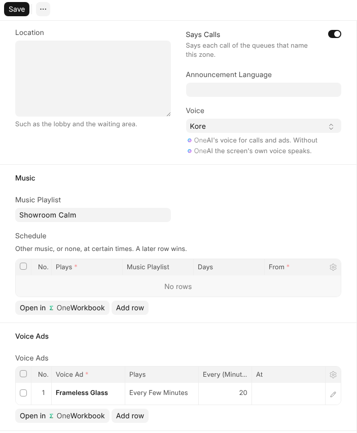
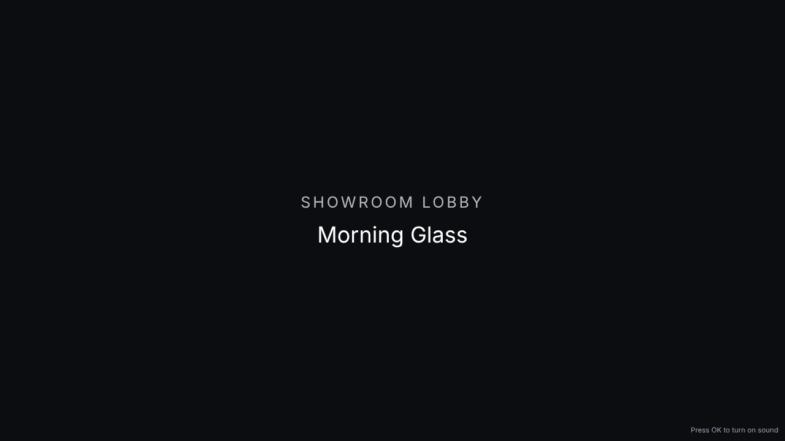
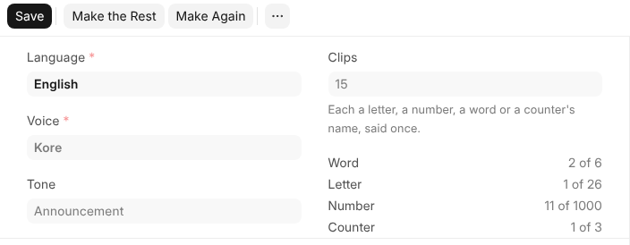

# Sound

What a screen shows and what people hear are set apart. A channel is only
what is seen. A **sound zone** is what is heard where one set of speakers
is: a lobby, a waiting area, a showroom floor.

## A Sound Zone

| Part | What it is |
| --- | --- |
| **Announce Calls** | Whether a ticket called at a counter is said aloud here. A queue names the zone its calls are said in. |
| **Announcement Language** and **Voice** | The language calls are said in, and OneAI's voice. With no voice, a screen's own voice says them. |
| **Music Playlist** | The music, quietly under everything, with a **Schedule** for other music, or none, at certain times. |
| **Voice Ads** | Ads read aloud every few minutes, or at set times. |

An emergency alert is said in every zone, whatever is set here.

## Who Plays It

Whatever feeds the speakers plays the zone: an old phone, a stick or a
computer plugged into the amplifier. Open your workspace's address followed
by `/radio` on it, and add it as you add a screen, choosing its sound zone. A
radio shows only the zone's name and what is playing.

Where there are no speakers but a screen's own, give the screen a sound zone
when you add it and it plays the zone itself. Every radio and screen in one
zone plays the same music and says the same call at the same moment.

## A Video's Own Sound

Every video plays silently unless you turn on **Plays Sound** on it in the
editor, and the screen showing it has **Plays Sound** on too. While such a
video plays, the music of the screen's zone goes quiet, and comes back after.

## Calls From a Voice Pack

A call is joined from pieces OneAI says once: each letter, the numbers up to
999, a few words, and each counter's name. They are kept in a **Voice Pack**,
one for each language, voice and tone, so the first call of a new ticket
sounds as good as the hundredth. The pieces it lacks are said the first time
a call needs them; until they are ready the screen says the call in its own
voice. **Voice Pack** on a sound zone opens its pack, which shows how much of
each kind it has said.

**Record Missing Clips** has OneAI record everything the pack may still need,
and **Re-record All** records every clip again, replacing the old one. The pieces are files
in OneCloud, under **Records**, **Voice Pack**; deleting the pack deletes
them.

A queue's **Number Reading** chooses how a ticket's number is read: **Auto**
says four digits or more one by one and a shorter number whole, or always
**Digit by Digit**, or always the **Whole Number**.

## Music

A music playlist is a list of tracks, played one after the other, over and
over, at the volume you set. **Make Music** has OneAI write a piece of
instrumental music from a sentence. It arrives at the end of the playlist,
paused, and you are told when it is there; clear **Paused** once you have
listened to it.

## Voice Ads

A voice ad is a few sentences read aloud, in the tone and the voice you
choose, with a chime first if you like. **Make the Recording** has OneAI
record it, and **Listen** plays it before anybody hears it in a zone. You can
also upload your own recording. Its file is on the ad in OneCloud.
