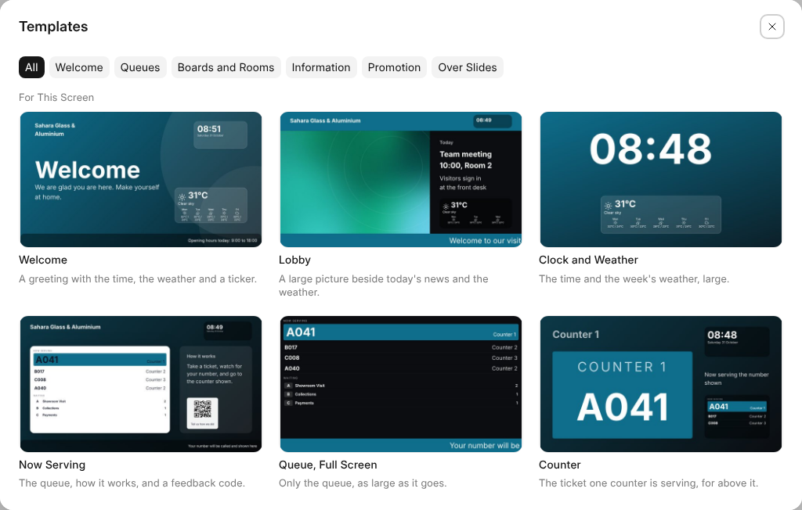
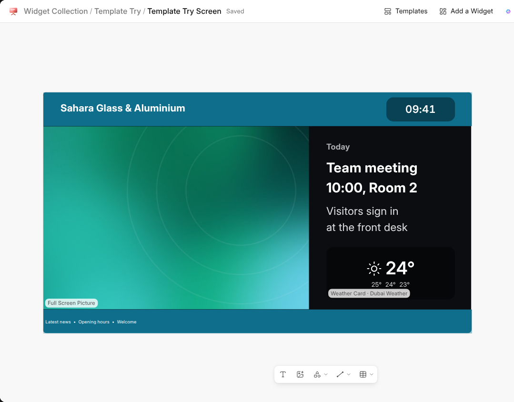
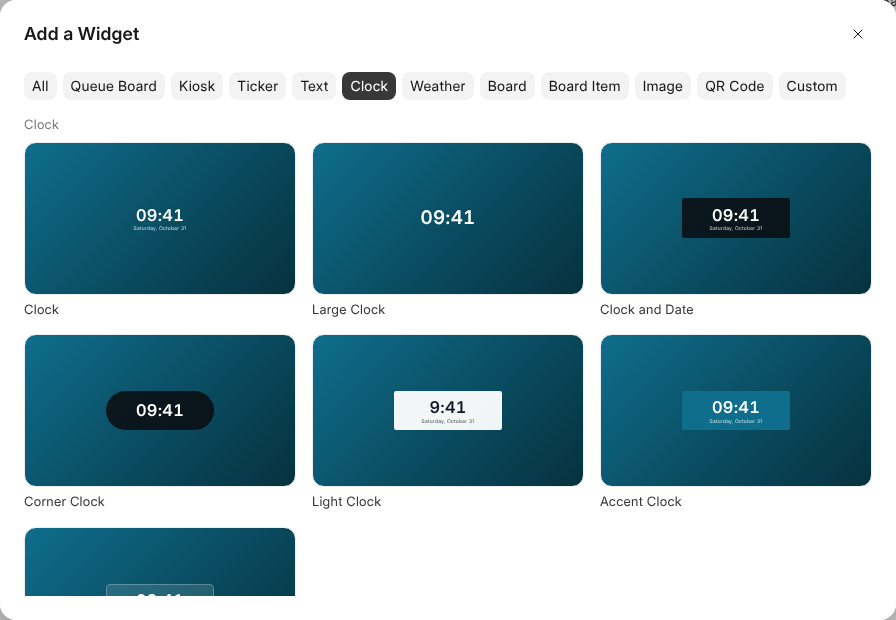

# Templates

A template is a whole screen ready to use: words, shapes, pictures and
widgets already placed, in your colour and with your logo. Pick one, change
the words, and the screen is done.

## Starting a Screen

A new layout opens on **Templates** in the editor. The ones made for the
screen's shape come first, and the rest are under **Other Shapes**. A
channel with no layout yet has **Choose a Layout**, which makes one and opens
it on the templates.

Templates are grouped by what they are for: **Welcome**, **Queues**,
**Boards and Rooms**, **Information**, **Promotion** and **Over Slides**.
The ones over slides leave the middle of the screen clear, so the channel's
slides show through.

A template's widgets read from your first source of the kind they need, so a
queue template shows your queue at once. A picture shows a placeholder until
you choose your own, and a QR code opens your workspace's address until you
change its link.

## Changing a Template

**Templates** in the editor's bar picks another at any time, in place of
what is on the screen. **Undo** brings back what was there. Every part of a
template can be moved, resized, restyled or removed like anything else on
the screen.

## Ready-Made Widgets

**Add a Widget** shows every widget drawn as it will look, with ready-made
versions of each: a large clock, a clock in the corner, a notice bar, a news
ticker, a door sign, a countdown, a code for feedback, and more. Each comes
in a look you can change in the panel, from Card and Glass to the Accent
looks in your colour.

