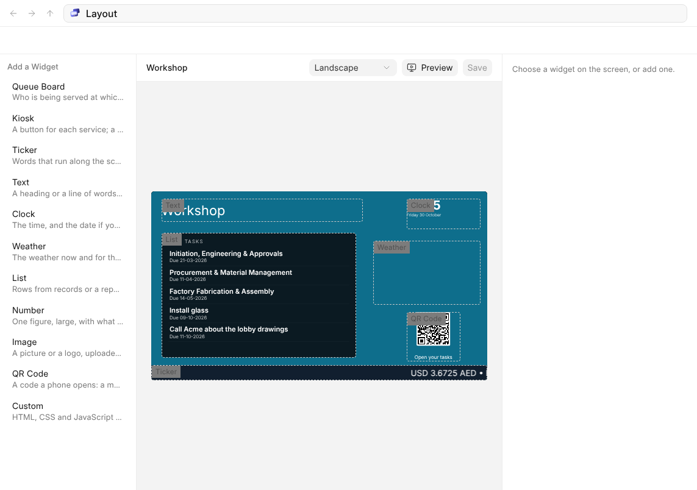
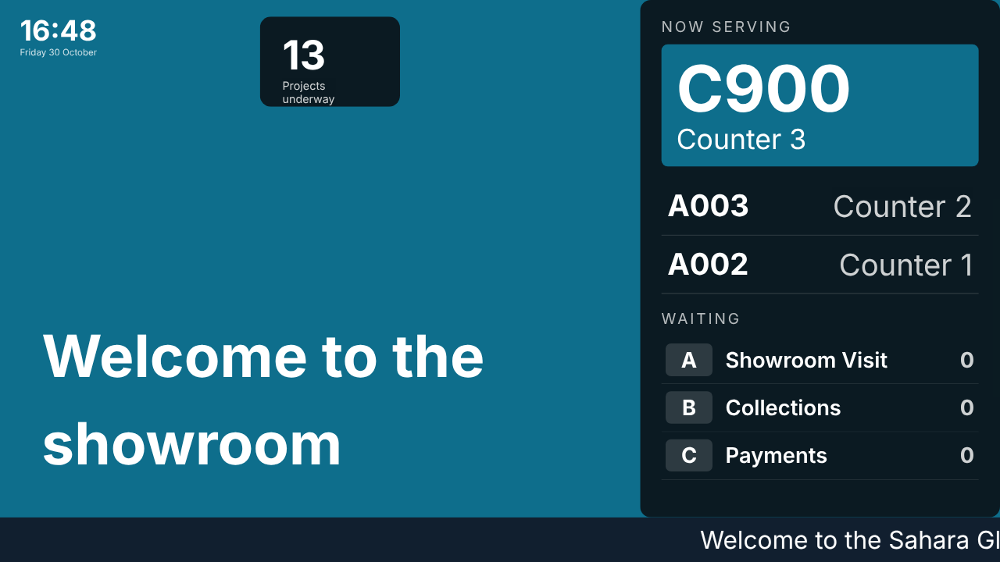
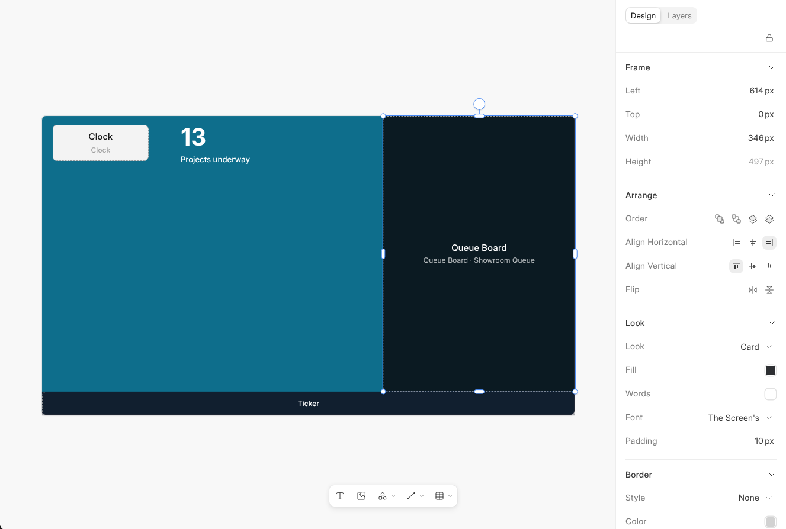

# Widgets and Sources

A widget collection is a layout of widgets on the screen. **Edit Layout** on a
collection opens it in OneSlide's editor, at the screen's own shape; a new
one opens on its [Templates](templates). **Add a Widget** shows every widget
and its ready-made versions, drawn as they will look, and puts the one you
choose in the middle; drag it into place, pull its handles to size it, and
line it up with the others as you would anything on a slide. Click a
widget and the panel shows where it reads from and its settings.
**Preview** opens the screen as it plays.

## Words and Pictures

Text, pictures, shapes and lines from the bar under the screen go behind the
widgets: a heading, a band in your colour, your logo. **Layers** lists them
with the widgets, and **Background** in the panel, with nothing chosen, is the
screen's colour. Everything is kept as you work, and the screens show it the
next time they look.

## The Widgets

| Widget | What it shows |
| --- | --- |
| **Queue Board** | The tickets just called and to which counter, and how many wait. |
| **Kiosk** | Buttons that hand out a ticket for each service. |
| **Ticker** | A line of text running across the screen, or the titles from a source. |
| **News** | The latest headlines from your News Sources, with their pictures and where they are from. |
| **Text** and **Clock** | Words you write, and the time and date. |
| **Weather** | Today's weather and the days ahead, for a place you choose. |
| **Board** and **Board Item** | Every item on a board, or one item large. See [Boards](boards). |
| **Image** and **QR Code** | A picture, or a code that opens an address on a phone. |
| **Schedule** | The day's sessions, a line each: time, what and where. The one on now is marked and the ones over fade. |
| **Opening Hours** | Your hours for each day, with today marked and whether you are open now. |
| **Custom** | A widget of your own, written by OneAI from a sentence. |

A widget can show always, or only between two times of day.

## Ways to Show

Most widgets can show the same thing in more than one way. Choose one under
**Layout** in the panel; the widget keeps its source and its look.

| Widget | Layouts |
| --- | --- |
| **Queue Board** | Now Serving, Latest Call (one ticket, large), One Counter (the ticket one counter is serving, for above its desk; say which under **Counter**), Every Counter (a tile for each counter), Recent Calls, Waiting by Service. |
| **Weather** | Week Ahead, Today (with the high, low, wind and humidity), By the Hour, Week as a List (each day's low to high drawn to scale), Compact, Large Temperature. |
| **Clock** | Digital, Analog, Date Card, Time and Day, Time Only. |
| **Ticker** | Scrolling, One at a Time, With a Label, Rolling Up. |
| **News** | One Story at a Time, Headlines, Cards. |
| **Board** | Tiles, List, Count by State. |
| **QR Code** | Code and Caption, Caption Beside, Wi-Fi (a code a phone joins your network from, with the network's name and password beside it). |
| **Schedule** | The Day, every session with the one on now marked, or Now and Next, the session on now and the one after it, large. |
| **Opening Hours** | The Week, a line for each day with today marked, or Today Only, open or closed and today's hours. |
| **Kiosk** | Grid, a tile for each service, or List, a row for each with how many are waiting. |

## How a Widget Looks

A widget draws only what it shows. Its fill, its words' colour, its font,
padding, border, corners and shadow are set in the panel like anything
else on the screen. **Highlight** is the colour of what stands out inside
it: the newest call, the kiosk's buttons, a ticker's label, the second
hand. It is your business's colour until you choose another, and the words
on it turn dark on a light colour by themselves.

A widget sizes its words to fit its box. **Text Size** makes all of them
larger or smaller, and **Main**, **Labels** and **Details** change one kind
at a time: the ticket number or the temperature, the small words above it
such as "Counter 1", and the lines under it. The main figure never grows
wider than the box. **Look** gives a set of these in one go, which you can
change afterwards: Card, Light Card, Soft, Floating, Glass, Dark Glass, Pill,
Rounded, Outline, Band, Light Band, Solid, Highlight, Alert and Contrast, and
four in your own colour, Accent, Accent Band, Accent Pill and Accent Outline.

## Data From Your Records

Text and tables on a screen can carry data from your records, as on any
slide: **Data** in the editor's **File** menu adds a source, and a figure or
a row's fields go into the words. On a screen, a display source can be used
as well. When a record it reads is saved, the screens showing it hear at
once.

## Sources

A source is where a widget's rows come from: your records, filtered as you
like, one record, a report, a queue, news, the weather, or exchange
rates. A widget's
slots are filled from a source's fields, such as a list's line saying a
project's name and its status. A source reads as the person who saved it, so
a screen never shows what that person could not see, and only the fields a
widget uses leave the workspace.

**News** reads the headlines of the News Sources you choose, which One
fetches on each source's own schedule (see One's Help, under News). Choose
**By Category** to keep a category's headlines together. A ticker can show
each category where its headlines begin, or in its label as they pass; put a
publisher's logo before or after each headline; and put a mark, your
company's logo or icon, words of your own, or only space between them.
**Rolling Up** runs the headlines up the screen with a line for each
category.

**Exchange Rates** reads the rates already in your workspace, for the
currencies you list, in your company's currency or another you choose. A
ticker filled from it runs "USD 3.6725 AED • EUR …" along the screen.

The weather comes from outside the workspace, so an administrator turns it
on first in TrustCenter, under the services OneDisplay may reach.
