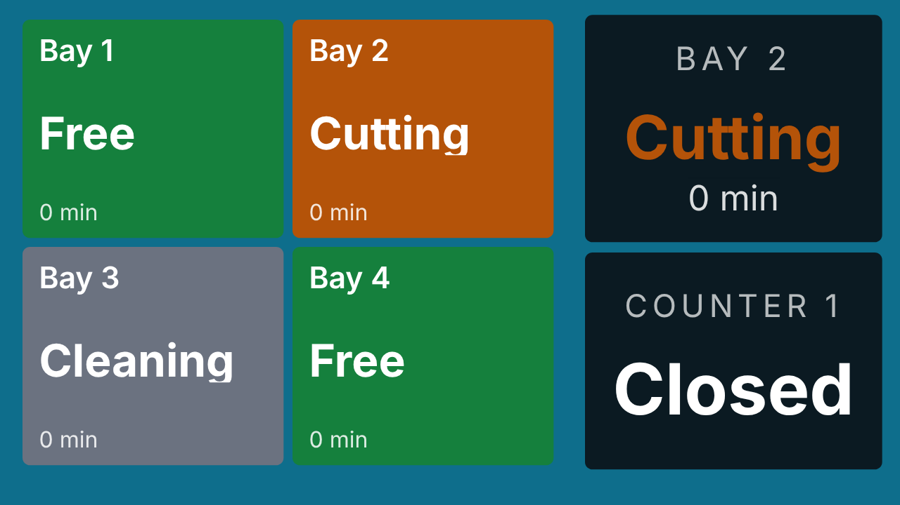
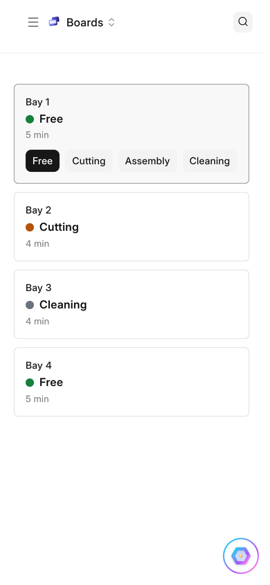

# Boards

A board keeps track of things whose state or value people change by hand,
and shows them on screens: rooms that are free or in use, bays and what is
happening in each, tables, beds, a score, today's special, a wait time.

## Setting One Up

A **Display Board** has its **Items**, the things on it, and its **States**,
what an item can be, in order, each with a colour and, if you like, a
**Time Limit**. An item can carry a **Value** instead or as well, a number or
a word, named as you like: Score, Count or Price. **People** says who may
change the board; with nobody named, everyone with {one_display} may.

## Changing It

**Boards** opens the board on a phone or a tablet. Tap an item, then its new
state, or change its value. **QR Codes** on the board prints a code for each
item: stuck on a door, it opens that item's buttons on whoever's phone scans
it. A change is on every screen showing the board at once.

## On a Screen

Two widgets show a board. **Board** shows every item as a tile in its state's
colour, with how long it has been so. **Board Item** shows one item large,
or, pointed at a queue's counter, what the counter is serving, flashing when
it is called and saying what you set when it is idle.

## Past Its Time

An item that stays in a state longer than the state's time limit is **Past
Its Time**: its tile says so, and the board's people are told. Every change
is kept as a **Display Board Change**, with how long the item had been in
its state before, so you can read back how long things take.
