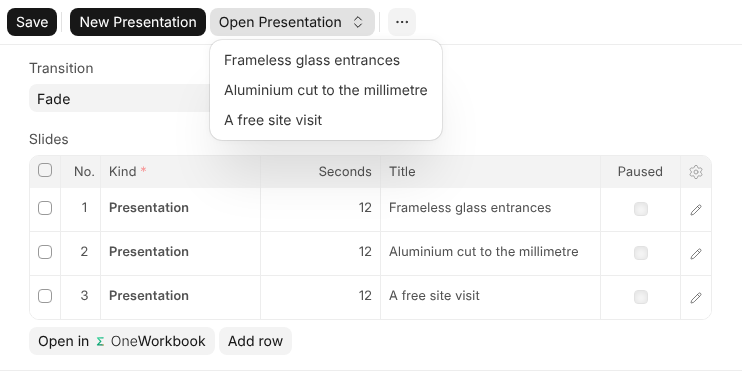
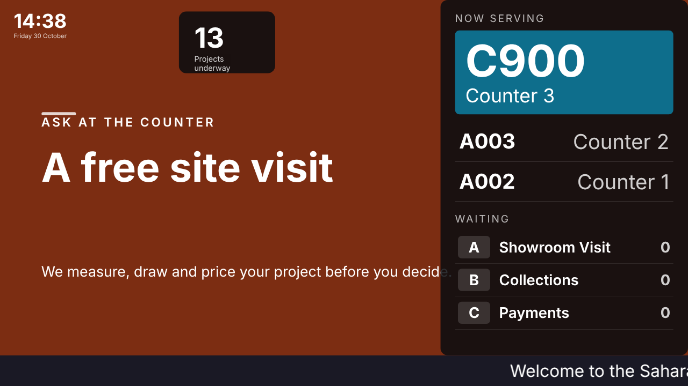

# Slides

A slide playlist is a list of what a screen shows, one after the other, over
and over.

| A row can be | What it is |
| --- | --- |
| **Presentation** | A presentation from {one_cloud}. Every slide of it plays, each for its own time, or the row's seconds when it has none. |
| **Web Page** | Any page that allows being shown inside another. |

A row can be given dates to show between, so a promotion leaves the screen
on the day it ends without anybody remembering to take it off. A row marked
**Paused** stays in the playlist and is not shown until you clear it.

## Making the Slides

Slides are made in {one_deck}, the same editor as any presentation in {one_cloud}.
**New Presentation** on a playlist makes one filed on the playlist, adds it
as a row, and opens it. **Open Presentation** goes back to any of the
playlist's presentations. A row can also play a presentation you already
have: choose it in the row's **Presentation**. Only presentations you may
open are offered.

To show a photo or a video, drop the files on the playlist, or use **Add
Pictures and Videos**. Each becomes a presentation of one slide that it
fills, filed on the playlist, without opening the editor.

A row whose presentation is another shape than the screen is shown whole,
with bands at its sides. **Fill Screen** on the row fills the screen instead
and trims the edges.

Text, pictures, videos, shapes, fades, blur, CSS of your own and tables all
play on the screen as they look in the editor. Whatever you change in the
presentation is on the screens at their next look, without touching the
playlist.

## How Long Each Slide Stays

Each slide stays up for its own **Advance** time in {one_deck}, or for the
row's **Seconds** when it has none. A video that does not loop is watched to
its end first, then the slide waits its Advance. A slide changes with its own
transition: a fade, a slide in from the side, or a cut; Magic Move fades on a
screen.

A picture is sent to each screen as sharp as that screen can show and no
sharper, so a 4K screen gets the detail and a small one is not slowed down by
it. Your original is kept as it was.

## Things That Come and Go

Something on a slide can come in after the slide does, and go again: fade
in, fly in from a side, zoom or rise, stay a while, and leave. Set it under
**Motion** in the editor; with **Repeat** it comes and goes for as long as
the slide is up. On a screen, something set to come **On Click** comes a
moment after the one before it, since nobody clicks a screen.

## Made With {one_ai}

In a presentation, **{one_ai}** designs a slide from a sentence in your brand's
colour, makes a picture, or makes a short video, which arrives on a new slide
a few minutes later. See [Asking {one_ai}](asking-oneai).
