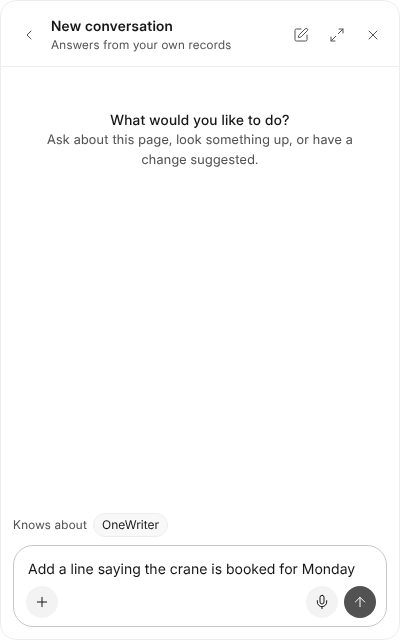

# Asking OneAI

When OneAI is on, ask it in its own panel at the bottom right, as anywhere
else. On a document it already knows which document is open, what it says,
and what you have selected, or the paragraph your cursor is in.

## What to Ask

| Ask | What happens |
| --- | --- |
| "Make this shorter", "translate this into Arabic" | A card that puts new words in place of your selection. |
| "Add a paragraph on the payment terms after this" | A card that puts it after the paragraph your cursor is in. |
| "Add a summary at the end" | A card that adds it at the end. |
| "Make a covering letter on this quotation from the template" | A card that makes a new document, on the record, from the template. |

Nothing changes until you approve the card. Approving puts the words into
the document as one edit, which undo takes back. OneAI also finds documents
by name and reads them, but only ones you may open.

## A Picture

**Make a Picture with OneAI**, beside the picture button in the bar, asks for
a sentence and a shape (wide, square or tall) and puts the picture OneAI makes
where your cursor is. It is kept in the document like a picture you put in.

Each question uses credits like any other. An administrator can turn OneAI
off for OneWriter in AICenter.
