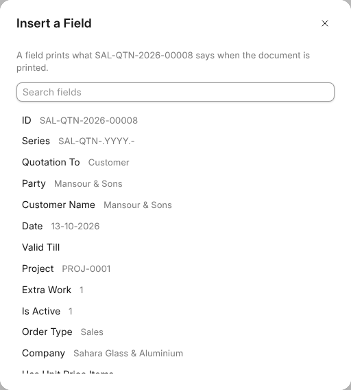

# On a Record

A document can belong to a record: a covering letter on a quotation, the
minutes on a project. Whoever may open the record may open its documents, and
whoever may change the record may change them.

## A Document on a Record

A record's **Files** tab is OneCloud, so **New › Document** there files the
document on the record. Its path starts with the record, and leads back to
it. The record's own print page lists its documents under the letter head.

## A Record's Fields

On a document filed on a record, **File › Insert a Field** lists the record's
fields with what each says now. The one you pick goes in as a grey block with
its name. On paper the block is what the record says at that moment: a total
as an amount, a date as a date, and the lines as a table. So a covering letter
stays right when the quotation changes.

## A Record's Text

A text with a formatting bar on a saved record, such as a quotation's terms,
has **Open in OneWriter** under it. What you write there becomes the text,
saved through the record two seconds after you stop typing. If the record
refuses it, the reason shows under the head and nothing is written.

If the text is changed on the record while the document is open, the
document does not write over it: it says so, and opening it again from the
record starts from what the record says. A submitted record's text opens to
read only.
