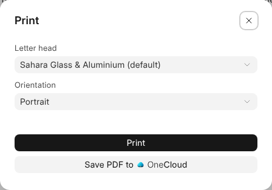

# Printing and Word

A document prints under the business's letter head, and it is a Word file
wherever it leaves One.

## Printing

**File › Print**, or Ctrl+P, opens the Print dialog. Choose the letter head
and the orientation, then **Print** opens the PDF in a new tab to print from
there. **Save PDF to OneCloud** keeps it beside the document; for a document
on a record, **Attach PDF to** the record keeps it there instead.

Page Setup's header and footer, page numbers and lines print on every page.
Pictures print as they are; a typeface prints as the nearest serif,
fixed-width or sans.

## A Word File

On the network drive a document is a Word file, such as "Scope of works.docx",
and so is a document downloaded through a link or attached to a mail. Its
headings, lists, tables, pictures and page breaks go with it.

Open it in Word, change it and save: the document takes Word's version, and
what it said before is kept in Version History as **Before a Word save**. A
document with a record's fields in it opens in Word, but changes only in
OneWriter.

## Word Files in OneCloud

A Word file put into OneCloud opens in OneWriter. What you write is saved back
into the same file when you leave it, its old content kept in the file's
versions.

**File › Download as HTML** and **Download as Markdown** save a copy of it
to your computer.
