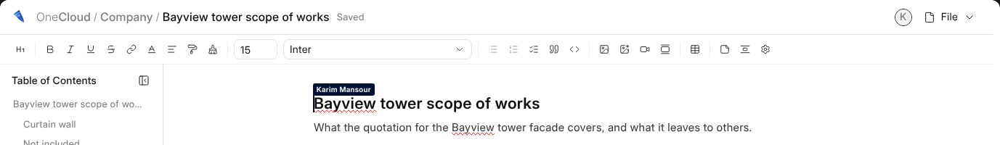
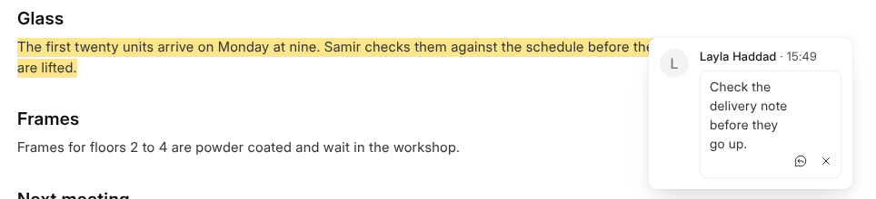

# Writing Together

Everybody with the document open writes in the same copy, at the same time.
Each sees the others' cursors with their name, and their faces in the head.

## Comments

Select some words and press the comment button beside them. The comment sits
in the margin beside the words, with your name, and the words stay marked
until it is resolved. Anybody may answer it.

Anybody who may open the document may comment on it, even somebody who may
only read it. The button at the top of the margin chooses what it shows:
the comments, the resolved ones, and the ones whose words are gone.

## Somebody Who May Only Read

Somebody the document is shared with to read sees the writing as it happens,
without the bar, and can comment.
