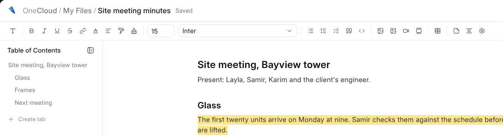

# Writing

The bar above the page holds everything that goes into a document. It is
there only for somebody who may change the document.

## The Bar

| Part | What it does |
| --- | --- |
| **Text** | Headings, bold, italic, underline, strike, links, colour and alignment. |
| **Format painter** | Takes the look of the words you are on and gives it to the next words you select. |
| **Size and typeface** | For the words you select. |
| **Lists and quotes** | Bulleted, numbered and task lists, quotes and code. |
| **Pictures and video** | A picture, a video or an embed, and **Make a Picture with OneAI**. Paste a picture or drop one on the page and it goes in too. |
| **Tables and page breaks** | A table, and a break that starts a new page on paper. |

## The Outline

The outline on the left lists every heading, and clicking one goes to it.
The button beside its title folds it away, to give the page more room.

## Page Setup

**File › Page Setup** sets the typeface, the size, the space between lines
and between paragraphs, and what prints in the header and footer. It sets
them for this document, or, under **Everywhere**, for every document you
open.

## Lock

**File › Lock** stops anybody typing into the document by accident, until
somebody unlocks it with the lock in the head.
