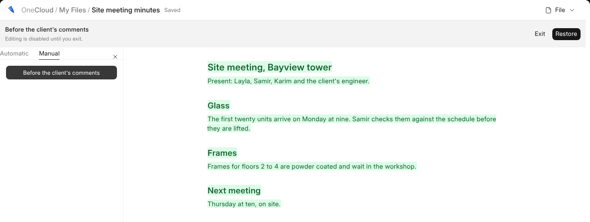

# History and Templates

Everything here is under **File** in the head.

## Version History

**Version History** lists what the document said. **Automatic** has one for
every ten minutes somebody writes; **Manual** has the ones somebody named
with **+**. Click one to see what changed since the one before. **Restore**
puts it back as an edit everybody sees, and undo takes it back.

Unnamed versions past the newest hundred go each night; named ones stay.

## Templates

**Save as Template** keeps a copy in {one_cloud} › Document Templates for
everybody in the business to start from: **New › Document** offers it, and
**Insert a Template** puts one where your cursor is. A template is its own
words and nothing else. Who may keep templates is set in **Roles**; see
[Who Can Do What](who-can-do-what).
