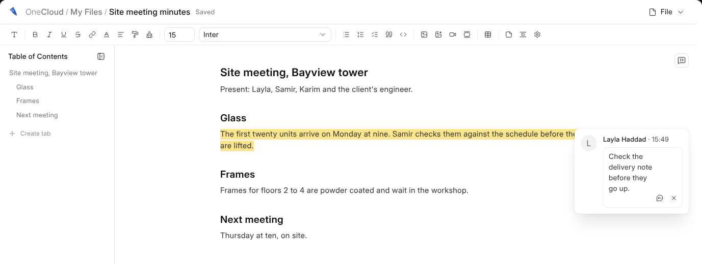

# What {one_doc} Is

{one_doc} writes documents: a scope of works, a covering letter, a method
statement, the minutes of a meeting. A document is a file in {one_cloud}, kept
beside everything else the business has, and opened by anybody it is shared
with.

## A New Document

**New › Document** in {one_cloud} makes one in the folder you are in, blank or
from a template, and opens it. Click a document in {one_cloud}, in a record's
**Files** or in a link in a mail to open it again.

It saves itself two seconds after you stop typing, and when you leave it: the
head says **Saving…** and then **Saved**. An untitled document takes its name
from its first line when you press Enter at the end of it.

## Finding Your Way

| You see | What it is |
| --- | --- |
| **The path** | Where the document is kept. Each step is a way back, and clicking its name renames it. |
| **The bar** | Headings, lists, pictures, tables and the rest. See [Writing](writing). |
| **The outline** | On the left, every heading. |
| **The margin** | Comments. See [Writing Together](writing-together). |
| **File** | Print, Page Setup, Version History and templates. See [History and Templates](history-and-templates). |

A document left for another screen waits on the bar under its title, with
{one_doc}'s mark, as a workbook does. Click it to go back, or × to drop it.
