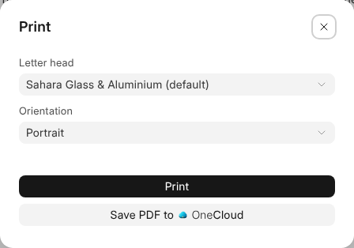

# Printing and Word

A document prints under the business's letter head, and it is a Word file
wherever it leaves {one}.

## Printing

**File › Print**, or Ctrl+P, opens the Print dialog. Choose the letter head
and the orientation, then **Print** opens the PDF in a new tab to print from
there. **Save PDF to {one_cloud}** keeps it beside the document; for a document
on a record, **Attach PDF to** the record keeps it there instead.

Page Setup's header and footer, page numbers and lines print on every page.
Pictures print as they are; a typeface prints as the nearest serif,
fixed-width or sans.

## A Word File

On the network drive a document is a Word file, such as "Scope of works.docx",
and so is a document downloaded through a link or attached to a mail. Its
headings, lists, tables, pictures and page breaks go with it.

Open it in Word, change it and save: the document takes Word's version, and
what it said before is kept in Version History as **Before a Word save**. If
the Word file had something a document doesn't keep, such as comments or
tracked changes, a bar says so the next time it opens. A document with a
record's fields in it opens in Word, but changes only in {one_doc}.

## Word Files in {one_cloud}

A Word file put into {one_cloud} opens in {one_doc}. What you write is saved back
into the same file when you leave it, its old content kept in the file's
versions. Saves within 10 minutes of each other are one version.

## When Something Would Be Dropped

{one_doc} keeps text, headings, lists, tables and pictures. When the Word file
has more, such as comments, tracked changes, headers and footers or
footnotes, a bar over the page names them, and what you write stays in
{one_doc} until you choose:

| Button | What it does |
| --- | --- |
| **Save Over Original** | Saves into the Word file and drops what the bar names. The file as it was is kept in its versions. |
| **Save as Copy** | Saves a new Word file beside it and goes on in the copy. The original stays as it was. |

A .docm file, which has macros, opens in {oneos} rather than here. While
somebody has the file open in {oneos}, it opens read-only here and says who.

**File › Download as HTML** and **Download as Markdown** save a copy of it
to your computer.
