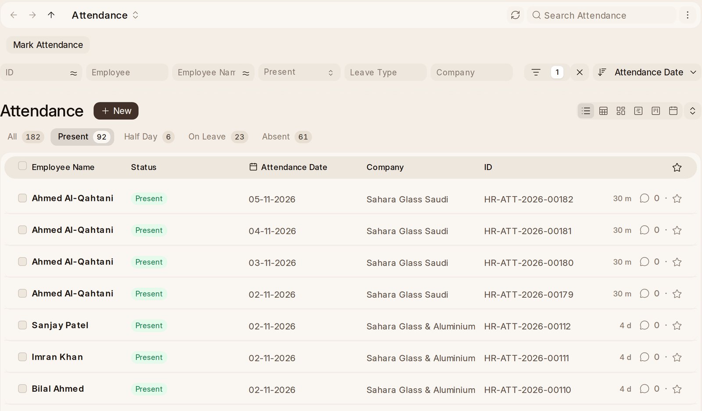

# Attendance

## Attendance Settings

The rail's **Attendance Settings** opens HR Settings on its Attendance tab:

- **Allow Employees to Check In Themselves** — the main switch, off until a
  workspace turns it on.
- **Auto Close Open Check-ins at Shift End**, **Require Reason on Check
  Out**.
- **Late Arrivals per Absent Day**: 0, which is off, or how
  many lates in a pay period cost one day's pay. At 4, four lates cost a
  day and eight cost two.
- **Require Passkey**, **Refuse Check-in Without Passkey**, **Check the
  Network**, **Check Location**, and **Network and Location**: Either or
  Both.
- **Refuse Below Score** (50) and **Flag Below Score** (85).
- **Require Photo**, **Delete Photos After (Days)**.
- **Learn New Networks**, **Learn New Locations**, **Include Personal Networks
  and Locations**, **Confirmation Threshold**.
- **Standard Working Hours (Per Day)** and **Allow Geolocation Tracking**.
  The second asks for a position on check-ins made anywhere but the Check In
  button; **Check Location** works with it off.

## Before Attendance Works

The setup wizard asks when people work — start, end and the weekly day off.
From that it makes this year's holiday list (with the country's public
holidays), assigns it, creates a **Day** shift ready to turn check-ins into
attendance, and creates the leave year and the payroll year.

If a shift is not set up to turn check-ins into attendance, its form says so
and offers **Read Check-ins**, and HR Managers are told once a week about any
shift that has check-ins and is producing no attendance.

## Attendance

**Attendance** in the rail is each person's day as it was marked: Present,
Absent, On Leave, Half Day or Work From Home. Check-ins become attendance
through the shift; leave and approved attendance requests mark their own
days. A working day the shift marked absent is told to the employee
(**Marked Absent**), in case they forgot to clock in.

## Marking Attendance by Hand

For people without a phone, or a day the clock did not cover:
**Mark Attendance** in the rail. Pick the day, then who, then what to mark
them as.
**Select Checked-In Employees** ticks everybody who clocked in that day, and
**Search** narrows a long list without losing the ticks.

## Requests and Their Answers

**Attendance Request** asks for days to count as worked — Work From Home, On
Duty, Customer Site, Training, Missed the Clock, or a reason the workspace
adds. **Shift Request** asks to work a different shift.

Both are answered the same way as leave and expense claims: **Approve** or
**Reject**, with a note. The record then shows who decided, when, and what they
wrote. Nobody approves their own request. A shift request goes to the
**Shift Request Approver** on the employee's record; when there is none, the
form says so. An attendance request goes to HR.

**Shift Assignment Tool** puts many people on a shift at once. Pick the
shift and the dates, narrow the list by branch, department or designation,
tick who, and press **Assign Shift**. Its other two actions give people a
shift schedule, or approve or reject a batch of shift requests together.

## Overtime

Record overtime from the employee's record or from the day's attendance: the
dialog shows the day and the standard working day before it writes anything.
An **Overtime Slip** collects the month's overtime into an Additional Salary
for payroll. A day's overtime cannot be paid twice.

## Timesheets

The timer on a timesheet only resumes a row that has a start and no end, and
it uses one clock, so a typed block keeps the hours that were typed.

## Time Reports

- **Attendance Overview** — today's numbers and the month.
- **Monthly Attendance** — one row per person for the month, including
  everybody with nothing marked, with holidays filled in.
- **Attendance by Shift** — every day in the period, including days with no
  shift, which it counts separately.
- **Hours Utilization** — hours logged on timesheets against the working days
  each person actually had. Drafts are counted separately.
- **Employee Checkin** — each log says whether it was Counted, Rejected,
  Flagged or Not counted yet.

## Who Does What

- **Employees** clock in and out, and see their own passkey and attempts.
- **HR Users** reset passkeys, work the review queue, mark attendance by hand
  and answer requests.
- **HR Managers** set the rules, block a passkey, and confirm or reject a
  learned network or location.
- Nobody approves their own team's devices.
