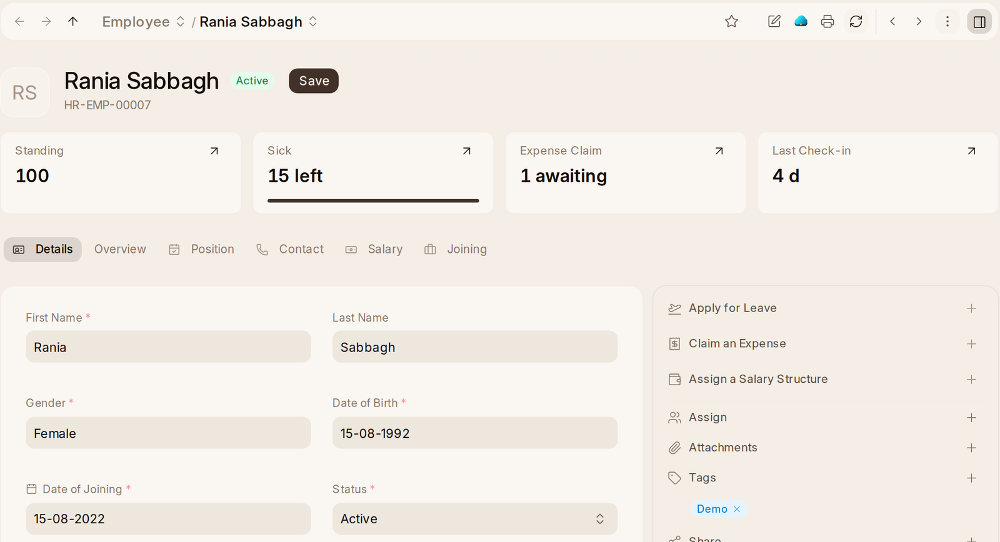

# The Employee Record

An employee's record answers the questions people open it for before anybody
clicks anything: where they are today, how much leave they have left, what is
waiting on an approver, what they are paid under, and how long they have been
here — and, when they hold any, how much of the company's equipment they
have. Each answer links to the record it came from.

**Identity Documents** — passport, national ID, residence permit, work permit,
visa, driving licence — each with its number, issue and expiry dates and a
scan. A workspace with a company in the UAE also has Emirates ID, Labour
Card, Health Insurance and Medical Fitness. Each kind says its country (empty
for every country), so a workspace adds its own country's kinds in Lists ›
ID Document Types, and a person picks only from their workspace's countries'
and every country's. People add and renew their own from
AccountCenter's Profile, and HR is told. OneAI, reading a document that
arrives, adds it to the person's record, or, when it renews a kind they
already have, puts it in that row's place (undone as one).

**Attendance Standing** is a score out of 100, worked out every night from the
last 90 days of check-ins. It never refuses anybody; it decides whose check-ins
count when OneHR learns a new office network or location.

**When somebody leaves**, setting their **Relieving Date** does everything that
should follow: on that day their status becomes Left, their login is switched
off, their passkey stops working, and their shift assignments end. A date set
in advance takes effect on the day. **Notice Ends On** shows the resignation
date plus the notice period.

Their **Separation** is the leaving checklist. HR submits it, and each step
becomes a task for its person: an exit interview, the final pay, and, for each
piece of the company's equipment they hold, a Return step for the stores.
Joining works the same way with an **Onboarding**.
