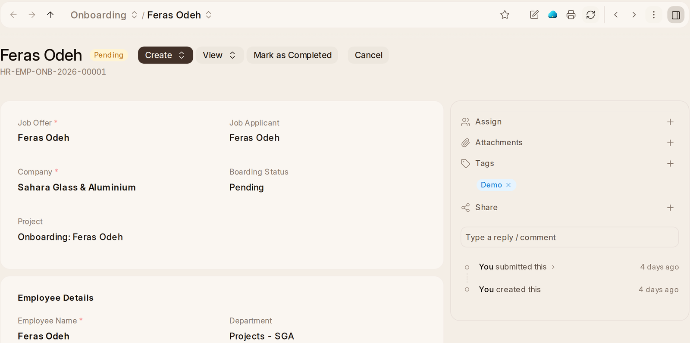

# Joining and Leaving

**Onboarding** needs a Job Offer, and the first one a workspace submits goes
through: the holiday list and the project dates are taken care of. Each
activity on it becomes a task for whoever does it, and **Create › Employee**
makes the new joiner's employee record. In the OneAI panel, *Plan the first
two weeks* suggests what their first days should hold and who owns each
part.

**Separation** shows its status in the list. Submitting one adds a **Return**
task for each asset the person holds (a laptop, a phone), for whoever looks
after the company's equipment; see OneInventory.

## Settling Up With a Leaver

**End of Service** is the leaver's gratuity. It works out what they are owed
by a rule (in the UAE, days of basic pay for each year served) from their
last payslip, and the books pay it. The UAE rules count no pay at all until a
pay component, such as Basic Salary, is added to the rule's **Applicable
Earnings Component**.

**Full and Final Statement** settles up with a leaver: what the company
still owes them, what they owe it, and any company property they have not
returned.

## Grievances and Letters

**Grievance.** An employee sees only the grievances they raised; HR sees
them all. Each new grievance is read by OneAI: a neutral summary, a
category and an urgency. One about harassment, discrimination or safety is
marked **Sensitive**, and from then on only HR Managers and the person who
raised it can see it, anywhere. HR Managers are told at once about a sensitive
or urgent one. OneAI never takes the mark off; only an HR Manager can.

**Letters.** An employee asks for a salary certificate, an experience letter,
an employment letter or a no objection certificate in the OneAI panel (**Ask HR
for a letter**). OneAI drafts it from their own record, the employee approves
the draft, and HR Managers are told. HR reads it and issues it by submitting.
It prints on the letterhead, marked *Draft. Not issued.* until then. HR can
ask for a letter about anybody from the employee's record.

## Training

**Training Program**, **Training Event**, **Training Feedback** and
**Training Result** list what each is about and when. A **Training Result**
records how each person did on an event: their hours, their grade and a
comment.

## Exit Interviews and Reports

**Exit Interview** asks a leaver why they are going, before they go: the
date, who interviews them, the **Interview Summary** and the **Final
Decision** (**Employee Retained** or **Exit Confirmed**). **Send Exit
Questionnaire** mails them the questionnaire HR Settings names.

**Exits.** **Employee Exits** opens on this year, so it shows who has left and
who is leaving. In the panel on exit interviews, **Why are people leaving?**
counts the reasons given over the last twelve months.

**Reports:** **Lifecycle Overview**, **Employee Birthday**,
**Employee Information** and **Employee Analytics**, which opens on
Department. **Employee Information** is everybody's details in one table, to
sort, filter and add columns to.
