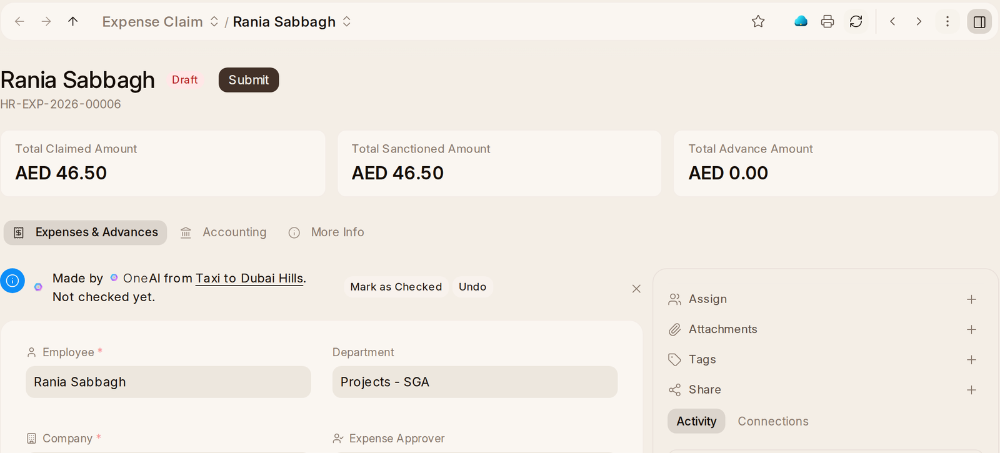

# Expenses

**Expense Overview**, first in Expenses, shows this month's claims, how
many were approved and rejected, and charts of claims over time, by type and
by department, and of advances by status.

## Claiming an Expense

1. Press **Claim an Expense** on {one_hr}'s Home, or on your employee record,
   or use **Expense Claim › + Add Expense Claim**.
2. Under **Expenses**, add a row per expense: the **Expense Date**, the
   **Expense Claim Type**, a **Description** and the **Amount**. Attach the
   receipts.
3. Pick your **Expense Approver** (the list offers the ones set for you or
   your department) and **Save**. It goes to them, or to HR when no approver
   is picked.

In the {one_ai} panel, *Claim a receipt* with a photo of the receipt fills in
the claim for you to approve, and *What can I claim?* says what may be
claimed and who approves it. A receipt sent in to {one_ai} becomes a claim
the same way. Once a claim is approved, accounts pay it with **Create ›
Payment** on the claim, and you are told when it is paid (**Expense Claim
Paid**).

## Approving and Paying Expenses

**Expense Claim.** The approver presses **Approve** or **Reject** with a note,
and the claim says what approving pays: *Approving this pays Omar Haddad back
AED 420.00*, including any advance that covers part of it. Nobody approves
their own claim. The cost centre is filled in.

**Employee Advance** is money given ahead, such as for a trip: the
**Purpose** and the **Advance Amount**. Once it is submitted, whoever
makes payments in {one_book} pays it with **Create › Payment**; HR does not see
that button. What was not spent comes back with **Create › Return**,
or is taken from salary with **Create › Deduction from Salary**. A later
expense claim takes the advance off what it pays back. The advance account
is set up out of the box.

**Travel Request** shows who is travelling and why at the top. It has no
approval step. The reasons it can give are kept under **Purpose of Travel**
in the rail; add one there when a trip fits none of them.

**Vehicle Log** says the distance and the fuel: *770 on the odometer since the
last log, on 58.00 Litre costing AED 179.80*.

**Who handles them.** An **HR User** makes and submits advances, travel
requests and vehicle logs, and an **HR Manager** also cancels them and keeps
the list of purposes of travel. What an employee sees of their own is
unchanged.

**Reports:** **Unpaid Expense Claim** and **Vehicle Expenses**, which opens on
this year.
