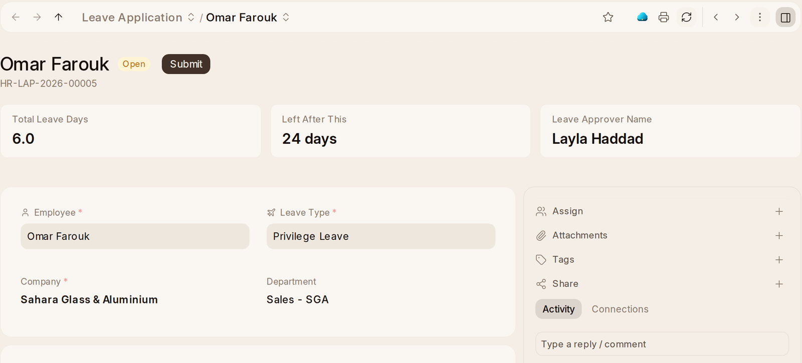

# Leave

## Applying for Leave

1. Press **Request Leave** on {one_hr}'s Home. **Apply for Leave** on your
   employee record and **Leave Application › + Add Leave Application** do
   the same. The cards at the top of Home say how many days of each leave you
   have left, and clicking one starts an application too.
2. Pick the **Leave Type**, the **From Date** and the **To Date**. Tick
   **Half Day** for half a day, and write a **Reason**. The table on the form
   shows what you have of each leave and what is already waiting.
3. **Save.** It goes to your **Leave Approver**, named on your employee
   record or your department, or to HR when there is none. It waits under
   **Your Requests** on Home's Today until it is answered.

At the top of an application are its days, how many days of its kind are
left once it is taken, and who approves it.

You are told the answer, with the approver's note. In the {one_ai} panel, *Book
time off* fills in the same application from what you tell it, for you to
approve. Approved leave that is cancelled later is told to the approver
(**Leave Cancelled**). Leave that does not carry forward is told two weeks
before it lapses unused (**Leave Expiring**).

## Approving Leave

**Leave Application.** The approver presses **Approve** or **Reject** and can
add a note. The page says what approving does: *Approving this books 3 days of
Annual Leave for Rania Sabbagh, 01-10-2026 to 03-10-2026, leaving them 18.* The
employee is emailed the answer, with the note. Nobody answers their own
request, leave or otherwise: somebody else who approves them has to. Requests
waiting for you are under **Waiting for You** on Home's Today.

While an approved leave runs, the person's workspace address answers new
mail on its own with the **Away Message** they wrote on the request, or a
standard one saying when they're back. Nothing is switched on or off: a
cancelled leave stops it at once (one_mail/help/rules-and-out-of-office.md, On leave).

## Giving People Their Leave

**The leave year** is created by the setup wizard, named after its year.
**Leave Control Panel** opens ready to allocate: the leave year's dates filled
in and the leave policy chosen when there is only one.

**Leave Allocation** lists how many days each allocation gives.
**Leave Policy Assignment** shows policies by name and when each starts.

**Leave Encashment** says the amount before you submit — *Submitting this pays
Lina Farah AED 700.00 for 7 days of Casual Leave* — or says what is missing:
the daily encashment amount on the salary structure or the person's
assignment. {one_hr} does not guess a daily rate.

**Reports:** **Leave Balance**, **Leave Balance Summary**, **Leave Ledger**
and **Working on a Holiday**. **Leave Ledger** lists every day of leave
given, taken, encashed or lapsed, one line each, so you can see where a
balance came from. An employee can have a holiday list of their own that differs from
the company's; Working on a Holiday reads theirs.
