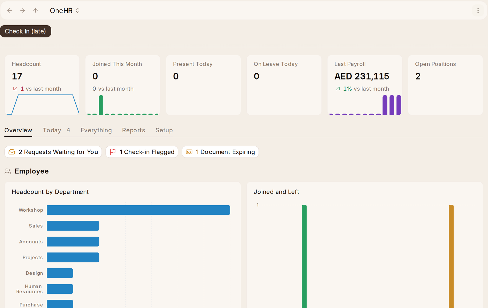

# What {one_hr} Is

{one_hr} is HR for every company in the workspace: people, attendance, leave,
pay, expenses, hiring, appraisals, and joining and leaving.

## Finding Your Way

The rail on the left has the whole of {one_hr} in it:

- **Home** — the page everybody starts their day on. **Check In**, **Request
  Leave** and **Claim an Expense** are its buttons, and the leave you have left
  is at the top. **Today** lists your own requests still waiting, the ones
  waiting for you to answer, and, for HR, check-ins flagged, passports, visas
  and permits running out, contracts and probations ending, and today's
  interviews. HR also sees the headcount, who joined, who is in and away today,
  the last payroll and the open positions, and an **Overview** of the people,
  their time, their pay and hiring. **Everything**, **Reports** and **Setup**
  list the whole of {one_hr} with what each is for.
- **Overview** — the people at a glance: headcount, who joined and who left,
  and the company by department, age and gender. Who is in, absent and on
  leave today is **Attendance Overview**, under Time.
- **Employee**, **Org Chart** (who reports to whom, drawn from each
  employee's **Reports To**) and **Setup** (see Setup below).
- **Time**, **Leave**, **Pay**, **Tax & Benefits**, **Expenses**, **Hiring**,
  **Growth**, **Joining & Leaving** — one group each, opened with the arrow.
  Pay has Employee Incentive, Retention Bonus, Arrear (back pay for a raise
  dated in the past) and Payroll Correction (days without pay given back);
  Growth has Transfer; Joining & Leaving has Exit Interview and the
  Full and Final Statement.

**One workspace is one company.** You are never asked which company a record
belongs to, and no screen, filter or report shows a Company field. Pay is in
the company's currency, so no payroll screen asks for a currency either.

**Names, not IDs.** Everywhere a record points at an employee, applicant,
leave policy or leave year, it shows the name — *Rania Sabbagh*, *Standard*,
*2026* — rather than HR-EMP-00001.

**{one_ai} is the round button in the corner.** Open it on any page and it offers
what makes sense there — "Claim a receipt" on expense claims, "Check this
payroll" on a payroll entry. No {one_ai} button is ever put on a page itself. See
**{one_ai} in {one_hr}** below.

## Several Companies

With more than one company, every employee, attendance, leave, claim, payslip,
payroll run, opening and review shows its **Company**, starting as yours, and
every list opens on your company. Home and its figures are your company's
alone, in its currency. Each company keeps its own holidays and weekend, its
leave year and the accounts its claims and payroll go to. Somebody limited to
one company sees only its people. Change company from the top bar.
