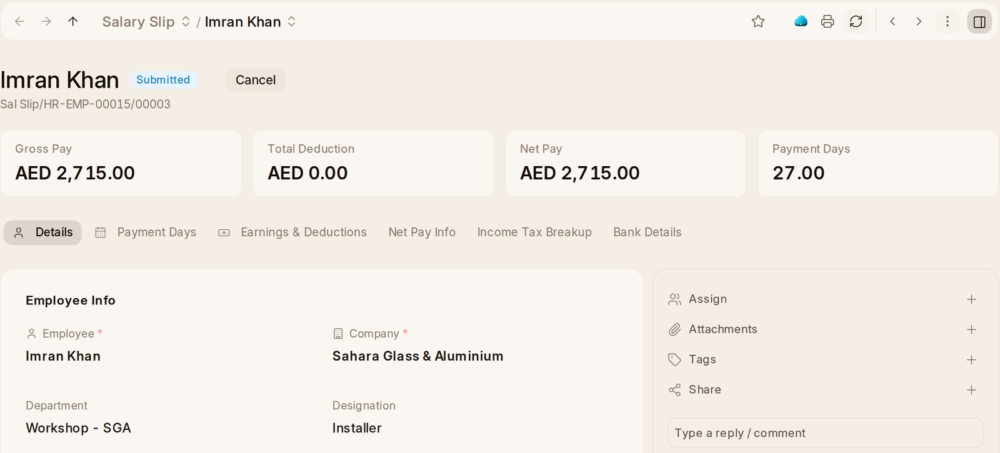

# Pay

**Payroll Overview**, first in Pay, shows the salary paid out month by
month, and last month's pay by department and by designation, with last
month's total pay and incentives beside it.

## Running Payroll

Everybody paid needs a **Salary Structure Assignment**: **Assign a Salary
Structure** on their employee record, or **Bulk Salary Structure
Assignment** for many at once (below). Then each month:

1. **Payroll Entry › + Add Payroll Entry.** Set the **Posting Date**, the
   **Start Date** and **End Date** of the period, and the **Payment Account**
   the pay leaves from. Save.
2. **Get Employees** lists everybody with a salary structure for the period.
   If any of them have overtime, **Create Overtime Slips** and **Submit
   Overtime Slips** come first.
3. **Create Salary Slips** makes a draft payslip for each. In the {one_ai}
   panel, *Check this payroll* compares every slip with last month's and
   names anybody missing.
4. **Submit Salary Slip** submits every slip and posts the payroll to the
   books.
5. **Make Bank Entry** records the net pay leaving the bank.

## The Payroll Screens

**Payroll Entry** says the whole run in one line: *01-08-2026 – 31-08-2026: 5
people, 27,500.00, in 5 slips still in draft*, and turns green when they are
all submitted. The payroll payable account is set up correctly out of the box,
so the first run works.

**Salary Slip** shows the net pay in the list, and the slip says the amount and
the period, and how many working days were paid when it was not a whole month.
When late arrivals count as absences, the slip says **Days Off for Late
Arrivals**, and they are in its Absent Days.

**Salary Register** opens on the most recent payroll run.

**Salary Structure Assignment** and **Additional Salary** show the amount in
the list. An **Additional Salary** adds a one-off earning or deduction, such
as a bonus, to the payslip of the month it is dated in. **Bulk Salary
Structure Assignment** puts many people on one
salary structure at once: pick the structure and the date it starts, and it
lists everybody with no assignment on that date. Narrow it by branch,
department, designation or grade, give each person their base and variable
pay, tick who, and press **Assign Structure**. **Salary Withholding** shows
the reason, and the period held.

**CTC Break-up** needs an employee and an assignment chosen before it shows
anything.
