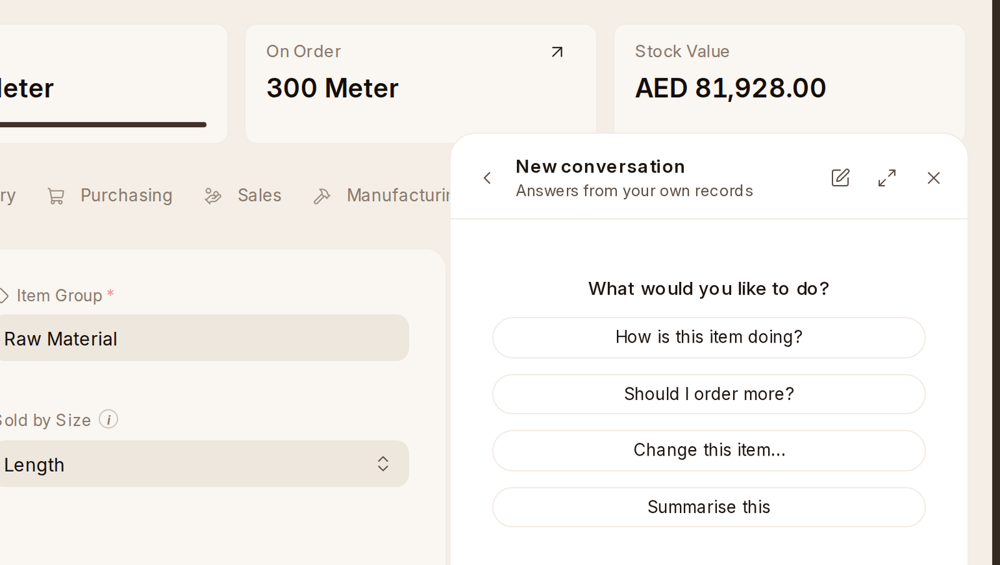

# Asking OneAI

The OneAI panel offers questions that fit the page you are on. Press one, or
type your own.

- **Home**: **Which orders are late?**, **What is running low?** and
  **Which services are due?**
- **An item's page**: **How is this item doing?**, **Should I order
  more?** and **Change this item…**, which suggests a change as a card you
  approve.
- **Stock Summary**: **What is running low?** and **What is short?** A
  warehouse: **What is this warehouse worth?** and **Record a count…**
- **Receiving and buying**: on a receipt, **What came in on this receipt?**
  and **What is still to arrive?**; on a purchase order, **Receive this
  order**, **Which orders are late?** and **What is still to arrive?**; on a
  material request, **Ask suppliers for prices** and **Compare the
  quotes**; on Request for Quotation, **Who has not answered?** and **Who
  is cheapest?**
- **Delivering**: on a delivery, **What went out on this delivery?** and
  **What is still to deliver?**; on a sales order, **Deliver this order**.
- **Moving and counting**: on a stock entry, **What did this movement do?**
  and **Send stock to a site**; on a count, **What did this count find?**
- **Batches**: **Which lots go off soon?** and **Where is each numbered
  piece?**
- **Equipment**: on an asset, **How is this asset doing?**, **Hand this to
  somebody…** and **Which services are due?**; on Asset Maintenance, **Which
  services are due?** and **What is out of order?**

Whatever OneAI would change or make, such as a receipt, a delivery, a
transfer, comes as a draft card you approve first.
