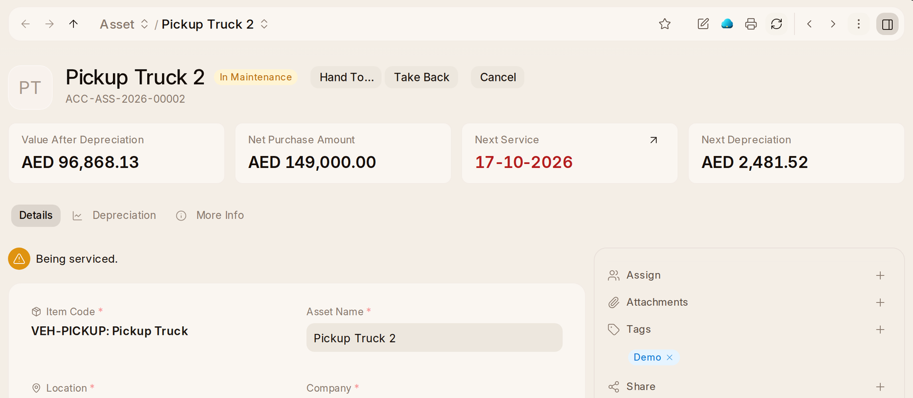

# Equipment

A laptop, a desk, a van: make it an item once, with **Is Fixed Asset** ticked
and its **Asset Category** (Computers, Furniture…). Then buy it like anything
else — a purchase order and a receipt. Each one received becomes an asset on
the register by itself: kept at your location, in use from the day it was
bought, and depreciating as its category says from the end of that month.

At the top of an asset's page: what it is worth now (**Value After
Depreciation**), what it cost (**Net Purchase Amount**), when it is next
serviced (**Next Service**) and its **Next Depreciation**. Below, its
**Depreciation** and how many months of its life are written off
(**Depreciations Booked**, with a line showing how far through). Once registered, a
chart beside them, also **Value After Depreciation**, is a line from what it
cost to what it will be worth at the end, one point per depreciation its
schedule books.
The Inventory Check's **Every asset is registered** turns **To Do** if one
could not register itself, and each says why on its page.

Equipment you already had is **Asset** in the rail, then **Add Asset**,
with **Is Existing Asset** ticked. The list says who has each piece.

## Who Has What

On an asset's page, **Give To…** asks for the employee and hands it over.
Once somebody has it, **Hand To…** passes it to somebody else and **Take
Back** returns it to a location. The person is told it is in their care.
Each handover prints as an **Equipment Handover** for them to sign: what
they were given, who gave it, and that they will look after it and give it
back when asked.

The asset says who has it, and the person's own page says how much
equipment they hold, to whoever runs HR as well. When somebody leaves, HR
submits their separation, and it gets a **Return** task for each thing they
hold, given to the stores.

## Servicing Equipment

**Asset Maintenance Log** in the rail lists each service: each service,
its asset and job, who does it, when it is due and whether it is
**Planned**, **Overdue** or **Completed**. Home says how many are due and
opens the ones still to do.

- **Mark Done** on a service asks the **Completion Date** and the **Actions
  Performed**, records them and works out the job's next date from that day.
- **Asset Repair** lists what broke, what is wrong and what each repair
  cost; **New Asset Repair** reports a breakdown.
- Each asset's servicing plan is an **Asset Maintenance** record: its team,
  and each job with how often and when it is next due.

OneAI answers **Which services are due?** and **What is out of order?** on
the maintenance log and on repairs.

Tick **Maintenance Required** on an asset that needs looking after, then
**New Asset Maintenance**: the asset, the maintenance team, and a row
per job — what it is, how often (monthly, quarterly, yearly…), from when,
until when if it stops, and who does it. Each due date is on that person's
calendar as **My Maintenance**, and on everybody's as **Maintenance Due**
when they turn it on, each named after the asset it is for; clicking one
opens it to record it done, and the next one is worked out from that day.
**Asset Maintenance Log**, under Everything on Home, lists every service
with its asset. The asset's page says its next service (**Next Service**),
in red once it is late.

The first schedule needs a maintenance team. The Inventory Check makes one.

Whoever does a service is told a week before it is due. Once it is late,
they and the team's manager are told. A schedule brought in from a
spreadsheet or by OneAI has its dates worked out the same as one typed in.

## Mending Equipment and its Value

When something breaks, **New Asset Repair** on Asset Maintenance: the
asset, when it failed, and what is wrong. The asset shows **Out of Order**
until the repair is **Completed**. The garage's bill is entered as a
supplier bill first, booked to repairs, and the repair takes its cost from
it. The repair says how long the asset was out of use (**Downtime**) and
what it cost (**Repair Cost**). The asset counts its repairs (**Asset
Repair**).

When something is worth less than its books say, after damage for
instance, an **Asset Value Adjustment** (under Everything on Home) sets its
new value. The difference is posted to the account you choose, and it says
the **Current Asset Value**, the **New Asset Value** and the **Difference
Amount**.
