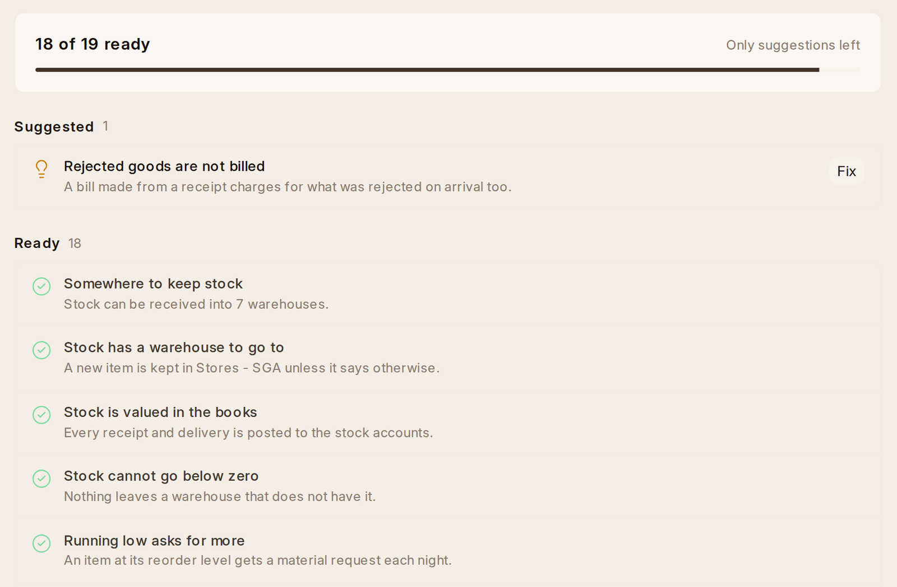

# Getting Ready

**Setup › Inventory Check** lists what would stop the first receipt, stock
count or asset, with **Ready**, **To Do** or **Suggested** beside each and a
**Fix** where there is one:

With more than one company, it checks the company you work in, named beside
the count. Change the company at the top to check another.

- **Somewhere to keep stock** and **stock is valued in the books** — a
  warehouse, and the company's stock accounts. A new company has both.
- **Stock has a warehouse to go to.** Without one, every receipt and count
  asks for a warehouse on each line. **Fix** makes the Stores the company's
  default.
- **Stock cannot go below zero.** If it could, what it is worth would go
  wrong with it. **Fix** stops it.
- **Running low asks for more.** An item at its reorder level gets a
  material request each night. **Fix** turns this on. **Reorder** lists
  what is low either way.
- **Rejected goods are not billed.** To begin with, what was rejected on
  arrival is billed too. **Fix** bills only what was accepted.
- **Stock can be held for an order.** Off to begin with, so stock promised
  to one order can go out on another first. **Fix** turns it on.
- **Every warehouse posts to a stock account** and **Stock values are up to
  date** — stock and the books agree. See When stock and the books disagree.
- **Stock and the books are put right each week.** Off to begin with, so
  stock valued wrongly, or apart from the books, stays that way until
  somebody recalculates it. **Fix** turns on a weekly recalculation of
  this year's entries.
- **Suppliers can be scored.** Nothing to score them by to begin with.
  **Fix** adds Delivered On Time and Accepted on Arrival, each out of 100.
- **Serial and batch numbers can be used.** Off to begin with, so no item
  can have serial numbers or batches. **Fix** turns them on. An item then
  has **Has Serial No** and **Has Batch No**.
- **Somewhere for an asset to be.** An asset needs a location. **Fix** asks
  what to call the first — Head Office, say.
- **Assets have categories.** **Fix** makes Computers and Software (written
  off over three years), Furniture and Office Equipment (five) and Machinery
  (ten), each kept in the chart's matching Fixed Assets account. Change the
  years under **Setup › Asset Categories**.
- **Depreciation posts itself.** Without it, depreciation is worked out but
  never posted unless somebody does it. **Fix** turns it on, so each
  asset's depreciation is posted to the books when it falls due.
