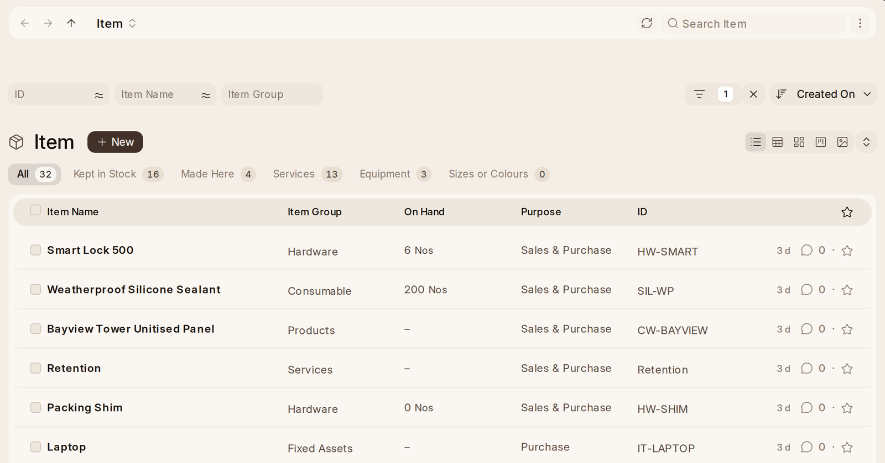

# Items

**Add Item** on the Items list asks what kind of thing it is first:

- **Kept in Stock** — counted in a warehouse.
- **Service** — work or a charge, never stocked.
- **Equipment** — owned and used, like a van or a laptop. It becomes an asset
  when it is bought.
- **Sizes or Colours** — one product in several versions. Pick the sizes and
  colours it comes in, and each combination becomes its own item.

Over the Items list, a tab for each kind says how many there are: **All**,
**Kept in Stock**, **Made Here**, **Services**, **Equipment** and **Sizes or
Colours**.

**Details** asks for its name, group, unit and a picture. **Sold by Size**
says whether each line gives its length (**Length**) or its length and width
(**Area**), so the quantity follows; a size that only prints, on something
counted by the piece (**Piece**), like a curtain-wall panel; or none (**No**).
See Selling by size.

**Buying, Selling and Stock** has a switch for each side. **Sold to
Customers** opens its selling price. **Bought from Suppliers** opens its
buying price and usual supplier. **Made in Our Workshop** adds a step for what
it is made from. **Order More When Low** opens the level to reorder at and how
many to order. **Kept In** and **On Hand Now** put its first stock in a
warehouse.

**Made From** lists the parts that go into one, with their quantities. It
becomes the item's bill of materials. **Add from a List** reads a parts list,
uploaded as a spreadsheet or CSV file or pasted in, with a code, name,
quantity and unit on each row. It matches each part to an item by its code, a
supplier's part number or its name, shows which are new, and adds the new ones
as stock items when you press **Add Parts**.

## Selling by Size

Glass, sheets, profiles, concrete and the like are sold by size. An item
whose **Sold by Size** says **Length**, **Area** or **Volume** gets
**Pieces**, **Length**, **Width** and **Height** on every line it is on, as
many of them as it needs: quotations, orders, deliveries, invoices, purchase
orders, receipts, stock movements, bills of materials and the rest. The
quantity is worked out from the size, in the line's unit, and the price,
tax, stock and cost follow from the quantity as on any other line.

- 4 glass panels of 1200 × 800 mm, sold by the square metre, come to
  3.84 m².
- 6 profiles cut at 2400 mm, sold by the metre, come to 14.4 m.
- 2 slabs of 100 × 50 × 20 cm of concrete, sold by the cubic metre, come to
  0.2 m³, or 200 litres if the line is in litres.
- An item kept by the piece says how big one piece is when it is made, such
  as a sheet of 3.125 m². Two sheets of 1250 × 2500 mm then come to 2 sheets.
- Any unit with a conversion set up also works, such as square feet.

Sizes are typed in the line's **Size Unit**: any length, such as
millimetres, centimetres or inches. A line takes it from its item's Size
Unit, and an item without one from the workspace's, in Stock Settings,
which is millimetres until somebody changes it. Change a line's unit and its
quantity follows. A line keeps the unit it was saved with, so changing the
workspace's later doesn't change what an old order meant.

An item counted in a length, an area or a volume, such as metres, square
feet or litres, is set to be sold by it when it is made or its unit
changes. A sheet kept by the piece is set by hand.

The size columns show only once a line's item is sold by size, and the quantity
shows its unit, such as 3.840 m². The size prints under the item's name on
quotes, orders, invoices and the other printed records, such as
"4 × 1200 × 800 mm", in the line's own unit. A quotation's sizes carry to the order made from it, and
on from there.

A unit that must be whole, such as Nos, stays whole. Selling 3 m² from a sheet
kept by the piece is refused, because that is not a whole sheet.
