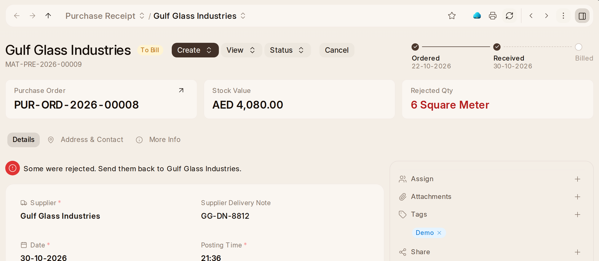

# Receiving and Delivering

Goods arriving from a supplier are taken in on a **Purchase Receipt**. Open
the purchase order and press **Create › Purchase Receipt**, or start one with
**New Purchase Receipt** on Home. Check the quantities against what came,
and submit it to put the goods into stock.

**Purchase Receipt** in the rail lists every delivery with its supplier,
where it stands, its date, its total and how much of it is billed. A
supplier's delivery note read from mail is already there as a draft, marked
as made by OneAI.

A receipt says above its fields its **Project**, the **Purchase Order** it
came on, what it is worth in the company's money (**Stock Value**, with the
supplier's own currency beside it when that is another; a service on it,
such as coating sent out, at what it cost), the **Landed Cost Voucher**
added to it, how much was rejected (**Rejected Qty**), and under
**Progress**: Ordered, Received and Billed. Under the exchange rate it says
what one of the supplier's currency is in the company's.

- **Something broken or wrong on arrival.** Put what came under Received, what
  you keep under Accepted, and the rest under Rejected with the warehouse it
  waits in. Only what was accepted goes on the shelf. An item marked
  **Inspection Required before Purchase** needs a quality inspection on its
  line before the receipt can be submitted. An inspection marked Rejected
  stops the whole receipt, so a delivery that is partly bad passes its
  inspection and has the bad part rejected on the receipt.
- **Freight and duty.** **Create › Landed Cost Voucher** on the receipt, add
  each charge, and submit. What each item cost goes up by its share, and the
  receipt says so. The accountant may add them too.
- **The bill.** **Create › Purchase Invoice** charges for what was accepted,
  once **Rejected goods are not billed** is Ready in the Inventory Check.
- **Paper.** A receipt prints as a **Goods Received Note**, with what was
  received, accepted and rejected on each line, signed by whoever delivered and
  whoever received.

Whoever asked for the goods on a material request is told when they arrive.
OneAI says what came in on a receipt, what is still to arrive and what is
late, and drafts a receipt for what arrived on an order as a card you approve.

## Delivering

The customer's order is OneCRM's and the invoice is OneBook's. What happens
between them is here.

Goods leave for a customer on a **Delivery Note**. On the submitted sales
order, press **Create › Delivery Note**, check what is going, and submit it
to take the goods out of stock.

**Delivery Note** in the rail lists every delivery with its customer, where
it stands, its date, its total and how much of it is billed.

A delivery says above its fields its **Project**, the **Sales Order** it is
for, its **Grand Total** in the customer's money (with the company's beside
it when that is another), the **Delivery Trip** taking it out with its date
and driver, and under **Progress**: Ordered, Delivered and Billed. Its line
says when some of it came back.

- **Hold stock for an order.** On a submitted sales order, **Stock
  Reservation › Reserve** sets stock aside for its lines, once **Stock can be
  held for an order** is Ready in the Inventory Check. No other order can
  deliver it. An item's page says how much of what is promised is held, and
  Free to Sell counts it once.
- **Pick it.** **Create › Pick List** on the order says what to take from
  which warehouse. It prints as a **Pick List**, signed by whoever picked and
  whoever checked. **Create › Delivery Note** on the pick list makes the
  delivery from what was picked. An order with stock held for it is
  delivered straight from the order instead.
- **Pack it.** **Create › Packing Slip** on a draft delivery says what went
  in which cases and what they weigh. It prints as a **Packing Slip** with the
  customer's address, signed by whoever packed and whoever received.
- **Take it to site.** **Create › Delivery Trip** on the submitted delivery
  names the driver, the vehicle and when it leaves, with a stop at the
  customer's address. **Notify Customers via Email** tells each customer on
  the trip it is coming. The route buttons appear once a Google Maps key is
  set in Google Settings.
- **Paper.** A delivery prints as a **Delivery Note**.

OneAI says what went out on a delivery, what is still to deliver for a
customer or project and how much of it is held, and drafts a delivery for what
an order still needs as a card you approve.
